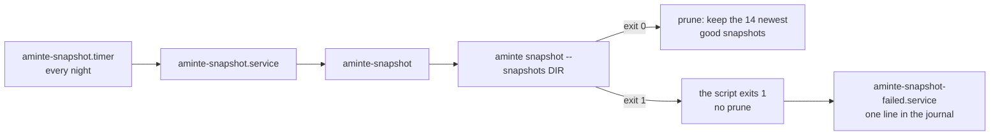

# deploy: reference files for the service and the nightly snapshot

These files are a **reference**, not the installed copies. The owner's machine has its own copies of the unit files
and of the script. Before you replace an installed file, compare it with the file here (for example with `diff`),
keep the settings that are only on the machine (the user, the paths), and then copy.

| file | installed as | what it does |
|---|---|---|
| `aminte.service` | `/etc/systemd/system/aminte.service` | runs `aminte serve` with `--with web` (the browser); `KillSignal=SIGTERM` and `TimeoutStopSec=30` let the server drain its requests |
| `aminte-snapshot` | `/usr/local/bin/aminte-snapshot` | runs `aminte snapshot`, tests its exit status, prunes to the newest 14 good snapshots |
| `aminte-snapshot.service` | `/etc/systemd/system/aminte-snapshot.service` | runs the script once; `TimeoutStartSec=30min`; `OnFailure=aminte-snapshot-failed.service` |
| `aminte-snapshot.timer` | `/etc/systemd/system/aminte-snapshot.timer` | starts the service every night |
| `aminte-snapshot-failed.service` | `/etc/systemd/system/aminte-snapshot-failed.service` | writes the failure to the journal |

`OWNER` and the paths in the units are placeholders.



## The snapshot names

[D25](../docs/decisions/D25-snapshots.md) gives the names. A snapshot that passes its restore check is
`life-YYYY-MM-DD.db`, or `life-YYYY-MM-DDTHHMMSS.db` when the day has one already. A snapshot that fails the check is
renamed to `life-YYYY-MM-DD.failed.db` (or `life-YYYY-MM-DDTHHMMSS.failed.db`). The script counts and prunes only the
good names. It never removes a `.failed.db` file: the owner reads it and removes it.

## The script

Settings come from the environment: `AMINTE_SNAPSHOTS` (required), `AMINTE_BIN`, `AMINTE_DB` and `AMINTE_KEEP`.
The script exits 1 when `aminte snapshot` exits with any other status than 0. systemd then starts
`aminte-snapshot-failed.service`. To read the failures:

```
journalctl -p err -t aminte-snapshot-failed
journalctl -u aminte-snapshot.service
```

## Ship a change

The service runs the installed program, not the one in the repo folder.

1. `go build -o <install path> ./cmd/aminte`, and every extension beside it, with one line:
   `for d in extensions/*/; do go build -C "$d" -o <install folder>/ ./cmd/...; done` (`<install folder>` is an absolute
   path, the folder of `<install path>`). Each program gets the name of its folder under `cmd/`: `aminte-web`,
   `aminte-mcp`, `aminte-agentic-init` and `aminte-gphotos`
   ([extensions](../extensions/README.md)). A unit with `--with NAME` needs the program `aminte-NAME` beside `aminte`:
   `serve` refuses to start without it, before the file opens. Ship `aminte` and each `--with` child together. The
   local proxy points to `AMINTE_WEB_LISTEN` (`127.0.0.1:7780`), and not to the core
   ([install](../extensions/web/README.md#install)).
2. `systemctl daemon-reload` after a change to a unit file.
3. `systemctl restart aminte.service`.
4. Read the service's log lines (`journalctl -u aminte.service -n 20`): the first names the version and the
   `user_version`, and a line `aminte: with NAME: started (pid N)` for each `--with` child (`web`) says that the child
   started. A line `ended with status 78: not started again (the owner acts first)` says that the owner must act
   ([the exit status](../extensions/README.md#run-by-serve)).
