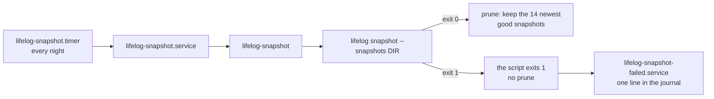

# deploy: reference files for the service and the nightly snapshot

These files are a **reference**, not the installed copies. The owner's machine has its own copies of the unit files
and of the script. Before you replace an installed file, compare it with the file here (for example with `diff`),
keep the settings that are only on the machine (the user, the paths), and then copy.

| file | installed as | what it does |
|---|---|---|
| `lifelog.service` | `/etc/systemd/system/lifelog.service` | runs `lifelog serve` with `--with web` (the browser), `--with agent` (the agent that answers) and `--with whatsapp` (the WhatsApp transport); `KillSignal=SIGTERM` and `TimeoutStopSec=30` let the server drain its requests |
| `lifelog-snapshot` | `/usr/local/bin/lifelog-snapshot` | runs `lifelog snapshot`, tests its exit status, prunes to the newest 14 good snapshots |
| `lifelog-snapshot.service` | `/etc/systemd/system/lifelog-snapshot.service` | runs the script once; `TimeoutStartSec=30min`; `OnFailure=lifelog-snapshot-failed.service` |
| `lifelog-snapshot.timer` | `/etc/systemd/system/lifelog-snapshot.timer` | starts the service every night |
| `lifelog-snapshot-failed.service` | `/etc/systemd/system/lifelog-snapshot-failed.service` | writes the failure to the journal |

`OWNER` and the paths in the units are placeholders.



## The snapshot names

[D25](../docs/decisions/D25-snapshots.md) gives the names. A snapshot that passes its restore check is
`life-YYYY-MM-DD.db`, or `life-YYYY-MM-DDTHHMMSS.db` when the day has one already. A snapshot that fails the check is
renamed to `life-YYYY-MM-DD.failed.db` (or `life-YYYY-MM-DDTHHMMSS.failed.db`). The script counts and prunes only the
good names. It never removes a `.failed.db` file: the owner reads it and removes it.

## The script

Settings come from the environment: `LIFELOG_SNAPSHOTS` (required), `LIFELOG_BIN`, `LIFELOG_DB` and `LIFELOG_KEEP`.
The script exits 1 when `lifelog snapshot` exits with any other status than 0. systemd then starts
`lifelog-snapshot-failed.service`. To read the failures:

```
journalctl -p err -t lifelog-snapshot-failed
journalctl -u lifelog-snapshot.service
```

## Ship a change

The service runs the installed program, not the one in the repo folder.

1. `go build -o <install path> ./cmd/lifelog`, and every extension beside it, with one line:
   `for d in extensions/*/; do go build -C "$d" -o <install folder>/ ./cmd/...; done` (`<install folder>` is an absolute
   path, the folder of `<install path>`). Each program gets the name of its folder under `cmd/`: `lifelog-web`,
   `lifelog-mcp`, `lifelog-agentic-init`, `lifelog-gphotos`, `lifelog-agent`, `lifelog-whatsapp` and `lifelog-ticktick`
   ([extensions](../extensions/README.md)). A unit with `--with web`, `--with agent` or `--with whatsapp` needs the program
   (`lifelog-web`, `lifelog-agent`, `lifelog-whatsapp`) beside `lifelog`: `serve` refuses to start without it, before the
   file opens. Ship `lifelog`, `lifelog-agent` and `lifelog-whatsapp` together. The agent writes its turn with the
   action `reply`, so a `lifelog` that lacks it makes `lifelog-agent` exit 78 and write nothing. The old
   `lifelog-whatsapp` answered by itself, so it beside the new `lifelog-agent` gives two replies to one message. The new
   `lifelog-whatsapp` without `lifelog-agent` gives none. The `state.json` of the old `lifelog-whatsapp` is a first run
   for the new one: it adopts the page as it is, and it reads the old `saved_at` as the time of the last message that
   was said, so a message that came during the switch is said. The local proxy points to `LIFELOG_WEB_LISTEN` (`127.0.0.1:7780`), and not to the core
   ([install](../extensions/web/README.md#install)).
2. `systemctl daemon-reload` after a change to a unit file.
3. `systemctl restart lifelog.service`.
4. Read the service's log lines (`journalctl -u lifelog.service -n 20`): the first names the version and the
   `user_version`, and the lines of `with web` say that the browser started.
