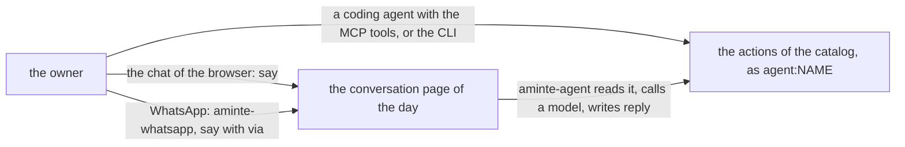

# 0093 — There are three ways for an agent to talk to aminte, and the owner wants one

- **Date:** 2026-11-09
- **Status:** resolved
- **Seen in:** the owner's review of the writer on 2026-11-09: "I want to remove the agent mode and the whole whatsapp
  integration. The thing is I will want to build an AI Agent that will be able to comunicate with aminte through cli
  and mcp rather than having mcp and then whatsapp agent and internal agent." Checked against the code at `7bc13da`.

## What happened

An agent reaches `life.db` in three ways. Each way has its own code, its own tests and its own failure modes.

The second and the third way need the conversation in the core: the actions `say`, `reply` and `settings`, the
resource `GET /days/{day}/conversation`, a reserved title, a reserved category, a format of turns with keys, and a
refusal of an agent's write of the body of a conversation page. They also need the chat in `aminte-web`, a model
endpoint and a WhatsApp pairing. The owner wants to build one agent outside, on the CLI and the MCP server, which work
without any of this.

## Reproduce

1. Count what carries the conversation at `7bc13da`: `internal/core/conversation.go`, `internal/core/settings.go`,
   `internal/api/conversation.go`, `internal/api/settings.go`, `siren/toolline.go`, the chat of `extensions/web`, and
   the modules `extensions/agent` and `extensions/whatsapp`.
2. Run an agent with `aminte mcp --agent NAME`: it reads and writes through the catalog and needs none of them.

## Rules involved

[RFC 0015](../rfcs/0015-no-conversation.md) removed the conversation once; plans 145, 146, 148 and 162 brought it back
as extensions. The [non-goals](../architecture/non-goals.md) row of a model inside the writer. The owner-only rule in
[API.md](../../API.md#reaching-a-server).

## Resolution

[RFC 0026](../rfcs/0026-no-agent-inside-and-no-whatsapp.md), option C, done by
[plan 163](../plans/163-one-way-for-an-agent.md). Nothing in the schema changes.
