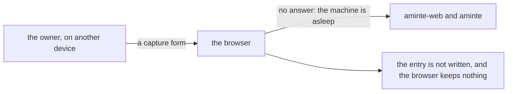

# 0094 — The journal takes no entry while the machine of the server is asleep

- **Date:** 2026-11-12
- **Status:** open
- **Seen in:** the owner's use on 2026-11-11, reported on 2026-11-12: "I closed the tablet ( this os ) on which aminte
  is running and I wanted to add some text to the daily journal. The problem was that it was offline and could not
  access the app. I want to be able to access the app even when it is offline ( as a PWA or something ) and when it
  connects back to sync with the master database."

## What happened

The writer runs on one machine of the owner, as a system service. The owner reaches the browser, `aminte-web`, from
another device through a proxy on the private network. The machine of the server was closed and asleep. The browser on
the other device got no answer, so the owner could not write the entry. The words were not written anywhere.

Expected: the owner writes the entry at that moment, and the journal gets it, one time, on the day and with the time
of the writing, when the server answers again.

Two parts of the writer were in the way:

- The browser had no way to keep a form that the server did not answer. The page of the browser extension said: "There
  is no service worker, since the server is the owner's own."
- The action `capture` gives an entry the time of the server at the write. An entry that is sent late would show the
  time it arrived.

## Reproduce

1. Start `aminte serve --token-file F --with web` on a fresh database, and open Home in a browser.
2. Stop the processes of the server (they do not answer, as on a machine that is asleep).
3. Write an entry in the capture form of Home and send it. The browser shows its own error, and the entry is lost.

## Rules involved

- [D3](../decisions/D03-integer-ids.md): a device that is offline queues only new rows and replays them through the
  API, each with an `import_key`. A copy of the database that merges is a [non-goal](../architecture/non-goals.md).
- [D28](../decisions/D28-capture-keys.md): a capture with a key that is sent again changes nothing
  (`capture_keys`).
- [D5](../decisions/D05-pages-and-day-pages.md): a day page is one body, and an entry has no timestamp of its own. The
  time of an entry is text at its start.

## Resolution

[Plan 165](../plans/165-the-journal-while-the-server-is-asleep.md), built and not yet closed. The browser keeps a
capture that got no answer and sends it again with its key, and `capture` takes the time of the writing in an optional
field. Nothing in the schema and no decision changes: the file already had the key (D28) and the rule (D3). The issue
closes when the service worker has been checked in a browser and the change is live, as the plan records.
