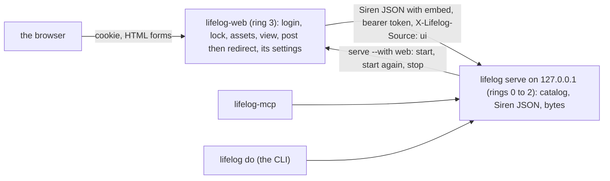
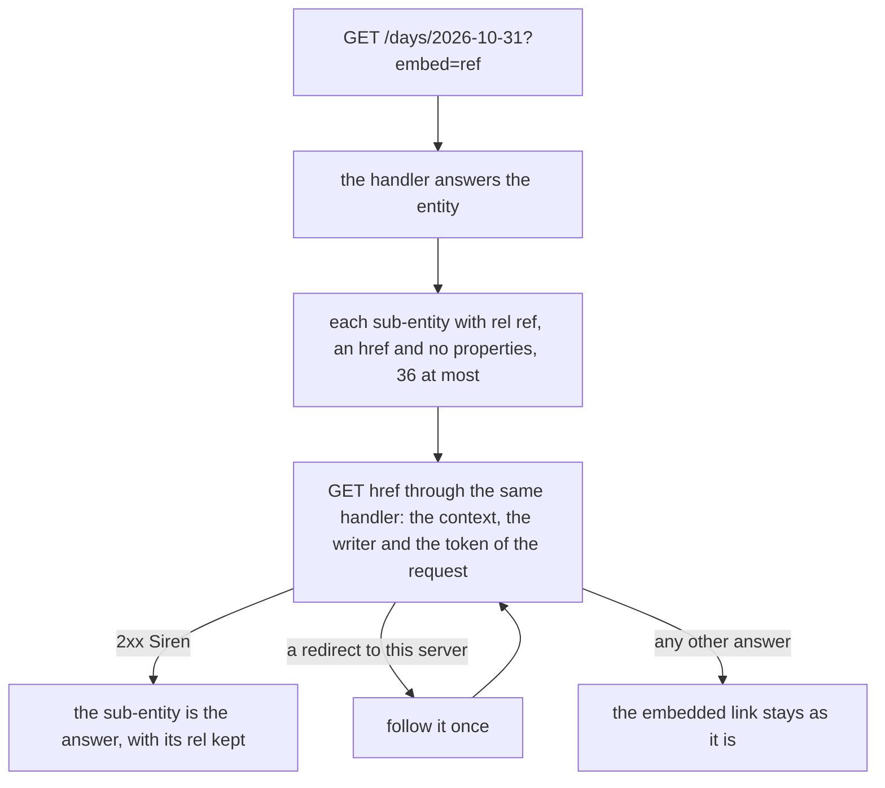

# 161 — The browser as an extension: a core with no HTML

> Dated implementation record. Tests use temporary folders and synthetic data. The owner's live `life.db` is never
> opened by a test.

## Status

- **Date / baseline:** 2026-10-31, `4899fbe` (master).
- **Priority:** P2. **Effort:** XL, in three stages. **Risk:** LOW for the file: nothing of `schema.sql` changes.
  HIGH for ring 2 and the service: the browser moves to a second process, the core loses `--public`, and the proxy
  points to a new port.
- **Status:** IN PROGRESS. Stage 1 and the parts A1, A2 and B of stage 2 are built and committed, and the findings of the
  counter-review (Opus, 2026-10-31) are fixed. The live move (item 6 of stage 2) and stage 3 are next.

| part | commit | what it holds | page time on a synthetic file (60 GETs, median) |
|---|---|---|---|
| stage 1 | `bc548e4` | `embed`; the shell reads only the API | day page 4.7 to 5.9 ms, browse 4.2 to 4.8 ms, metrics 4.9 to 6.3 ms, conversation 2.7 to 4.1 ms |
| stage 2 A1 | `c100c76` | `extensions/web`: the read side; 68 routes side by side | day page 14.3 ms from the core, 19.7 ms through web; browse 13.9 and 19.7 ms |
| stage 2 A2 | `7da7a3f` | the forms, the login, the lock and the settings of the browser; the catalog of web | none given |
| stage 2 B | `4bd6b6b` | `extensions/web/e2e_test.go` (the real `lifelog serve --public --with web`), `web/parity_test.go` (each action has its form), the steps to run it live in its README | none |

The commit messages give the page times. Each row was measured by its own test, so the rows are not one series: the time
before stage 1 and the time through web on the same file are still to measure with the same test, as the checks below say.

### The counter-review (Opus, 2026-10-31, on `4899fbe..4bd6b6b`)

Each finding was fixed with a test that held the fault first.

| severity | finding | fix |
|---|---|---|
| BLOCKER | The poll of `chat.js` asks for Siren JSON, and web drew a page: the column waited for ever, and its lock branch was dead. | A request that asks for Siren JSON and not for HTML gets the core's entity through web (no-store), and web's own errors as JSON. |
| HIGH | `/settings` had the core's `ground`, `lock_after` and `lock_pin` beside the form "This browser": a lock set in the core's form never locked web. | Web draws the core's form without the settings of the browser; one field for each. |
| MEDIUM | Web's catalog on `LIFELOG_LISTEN` took the settings from any local caller, also with another `Host` (DNS rebinding). | `app.Listen` refuses a `Host` that is not its address and a cross-site browser write, for every connected app. |
| MEDIUM | An address with a space in a tool line made the core panic in the embedded read. | The embedded read is made from the URL, not from a request line. |
| MEDIUM | The door decided by the decoded path, the routes by the escaped one (`/assets%2Ficon.svg`). | The door decides by the pattern of the route that answers. |
| MEDIUM | Exit status 2 meant "the owner acts", and the Go runtime exits with 2 on a panic: a crash stopped the browser for good. | `app.ExitOwnerActs` is 78 (owner's word); `serve` starts a child again after 2. A settings file that cannot be read now is status 1. |
| LOW | "This browser" was an app of the rail, and `/with/web` drew its form a second time; a double prefix of the log; the proxy of the environment could get the token; history in the README. | The rail lists no app web and `/with/web` leads to `/settings`; one prefix; no proxy; the README states the current truth. |

Left as they are: `quietKey` (stage 3 deletes the shell of the core with it); a redirect or a HEAD answer of the core is
closed unread; a restart of web gives 5 tries again (plan 160 accepts it).

## Context

The owner (2026-10-31): "right now we are doing SSR from the go application, but I wonder if we should actually
extract the html interface as an extension rather than a part of core. This way we won't enforce an UI for someone
that doesn't use it."

[Plan 135](135-extensions-outside-the-core.md) kept the browser in the core and said: "The owner decides again after
an extension proves the model." Five extensions (mcp, googlephotos, ticktick, whatsapp, agentic), the connected
apps ([plan 154](154-connected-apps-through-the-catalog.md)) and the task service
([plan 158](158-one-task-service-behind-tasks.md)) now prove it.

The README rejected "a separate web client" for three reasons: a second implementation of every view, the token where
JavaScript can read it, and a toolchain that changes every year. None of them holds for a renderer in Go on the
server that draws Siren. The view moves; it is not written a second time. The token stays on the server. There is no
build step.

The trigger of the question was a fault in the README: the rule "one script" says that a page has at most one
`script` element, `chat.js`, but plan 160 added `lock.js`. When the browser leaves the core, the rule leaves the
README of the core. The README of the extension states its own rule for its two scripts.

## The decisions (the owner's answers, 2026-10-31)

| subject | decision |
|---|---|
| goal | The core is headless: rings 0 to 2 hold no HTML, CSS, JavaScript or picture. The browser is one optional extension. Anyone can write another UI against API.md alone, in any language. |
| topology | `lifelog serve --with web` runs `lifelog-web` as a child. It is the front door of the browser, on `LIFELOG_WEB_LISTEN` (the unit sets it; the default is `127.0.0.1:7780`). The local proxy points to it. |
| the core on the network | The core listens on the loopback only. A token (`--token-file` or `$LIFELOG_TOKEN`) turns on the bearer check by itself. No token means no check, as the temporary server of `lifelog NAME` has today. `--public`, `--allow-origin`, `--tls-cert`, `--tls-key`, the cookie login and the lock leave the core. |
| remote use | Only the browser is remote. The proxy maps the name on the tailnet to web alone. The CLI and the MCP server run on the server. Web reads the allowed origins from `LIFELOG_WEB_ORIGINS` and the owner's token from `LIFELOG_TOKEN`, for its login and for its requests to the core. |
| the grammar | `internal/text` becomes the public package `lifelog/text`, the fourth after `siren`, `client` and `app`. It is the Go reference of [titles and wikilinks](../contract/titles-and-wikilinks.md). |
| the scripts | No interim fix in the core. `chat.js` and `lock.js` move with the browser. |
| the settings of the browser | `ground`, `lock_after` and `lock_pin_hash` move to `os.UserConfigDir()/lifelog-web/`, as actions of the own catalog of web at `/with/web`. A one-off step copies the owner's values. |
| parity | Each surface holds its own parity. The API and the CLI are in the core. mcp and web hold theirs by an end-to-end test against the real `lifelog`. The table of the README keeps its four columns. |
| the data of the shell | A generic `embed` in the API (below), not many small requests. |
| the rollout | In stages, side by side: stage 1 cuts the seam in the core; stage 2 runs web beside the old browser and compares their pages; stage 3 deletes the old browser. |
| the name | `web`: `extensions/web`, the program `lifelog-web`, `/with/web`. |
| the tests of web | A public test kit, `lifelog/lifelogtest`, gives a test an `httptest` server that runs the real core handler over a fresh synthetic file, in process. Only `_test.go` files import it. The tests of the pages move to web with their cases and keep their speed. |
| execution | Sonnet sub-agents build each stage. The main session briefs, reviews and runs the checks. Opus 5.5 does the counter-review. |

## The rule of embed (a new rule of API.md)

- `GET <a read>?embed=rel1,rel2` replaces each sub-entity of the answer that is an embedded link (Siren: `rel` and
  `href`, no properties) and that has one of those rels, by the entity that its `href` answers.
- The depth is 1. One answer embeds at most 36 entities. Each one is read through the same handler, with the context,
  the writer and the authority of the request. A redirect to a path of this server is followed once. A failure (not a
  path of this server, a status that is not 2xx, an answer that is not a Siren entity) keeps the embedded link as it
  is.
- It is the general form of `cardAt` in `internal/api/cards.go`, the one embed that the core does by hand today, and
  it replaces `cards`, `card`, `cardAt` and `chatExtras`.

## What ties the browser to the core today

`view.Draw(*siren.Entity, view.Facts)` (`internal/api/serve.go`) is almost a pure function already: the package
`view` imports only `siren`, `internal/text` and `internal/pixelart`.

| the tie | where | where it goes |
|---|---|---|
| `wantsHTML` chooses JSON or a page | `serve.go` (`answer`, `wantsHTML`) | stage 3: the core answers Siren JSON and bytes only; `Vary: Accept` and `Speculation-Rules` go |
| the shell reads `core.Store`: the clock, the ground, the Today strip (`Streak`, `Moods`, `Habits`), the chat, the links of the apps, the task service, the cards | `serve.go` (`pageAnswer`), `strip.go`, `cards.go` | stage 1: data on the entities, and embed |
| `SharedForms`: a browser form may send the fields of a second action | `request.go` (`known`), `view/forms.go` | stage 2: web sends only the fields of the action of the button |
| post, then redirect | `serve.go` (`serve`) | web |
| the writer `ui` by default | `serve.go` (`source`) | web sends `X-Lifelog-Source: ui` |
| the routes of the browser: the cookie login (`public.go`), the lock (`lock.go`), `POST /render` (`editing.go`; it resolves nothing), the fonts, the manifest, the icons, `/assets/*`, the pictures of pixelart | `serve.go` (`routes`) | web |
| `ground`, `lock_after`, `lock_pin_hash`, `grounds` | `internal/core/settings.go`, `internal/api/settings.go` | the settings of web |
| `view.Num`, `view.AppLink`, `view.ToolChip`, `view.Strip`, `view.Chat` in the api | `days.go`, `measurements.go`, `with.go`, `conversation.go`, `strip.go`, `chat.go` | stage 1: a small helper outside `view`; only the code that draws imports `view` |

## Stage 1 — the seam, in the core (a browser sees no change)

1. **Embed** on the reads, with its lines in API.md and its tests: the bound, the depth, a failure that keeps the
   link, the writer and the context carried, one redirect followed.
2. **The data that the shell needs, as data for every client:**
   - the day carries `streak` and `written`, and its habits with `done`;
   - the root carries `now` with its offset (the zone of the words), and sub-entities: `today` (the day),
     `conversation` (the conversation of today), each connected app (rel `app`) and the task service (rel `tasks`);
   - each turn of a conversation carries its refs as embedded links with rel `ref`.
3. `pageAnswer` makes `view.Shell` from one request through the handler, `GET /?embed=today,conversation`, and the
   cards from `?embed=ref`. A new function of `view` reads the shell from that entity. After that, `pageAnswer` and
   `view` read nothing of `core.Store` but the settings `ground` and `lock_after`, which move in stage 2.
4. The tests of the views keep their assertions. They show that the seam changed no page.

## Stage 2 — `extensions/web`, side by side

1. `internal/text` moves to `text`. The imports and the list of the public packages in AGENTS.md change with it.
2. The module `extensions/web` (`replace lifelog => ../..`; it imports `lifelog/siren`, `lifelog/client`,
   `lifelog/app`, `lifelog/text`) holds a copy of `view` with its templates and sheets, `pixelart`, the cookie login
   and the lock, `/render`, the assets, post then redirect, the split of `SharedForms` and `X-Lifelog-Source: ui`. The
   pictures and the files stream through it. The copy is for the time of the stage: stage 3 deletes the one in the
   core.
3. Its own catalog on `LIFELOG_LISTEN` through `lifelog/app`: the settings `ground`, `lock_after` and the PIN, in
   its state folder. Its front door on `LIFELOG_WEB_LISTEN`.
4. **The test side by side**, end to end: it builds the real `lifelog`, makes a synthetic file, and runs the old
   browser and web. For a list of routes that covers every template and the shell, it gets the page from both and
   compares the HTML. It names each difference that it allows, and it allows no other. Stage 3 deletes it with the
   old browser.
5. **The parity test of web:** each action of `GET /actions` has its form in web.
6. **Live:** build `lifelog` and `lifelog-web` into the install folder, add `--with web`, `LIFELOG_WEB_LISTEN` and
   `LIFELOG_WEB_ORIGINS` to the unit, copy the settings (a one-off line that the owner runs), start the service
   again, and the owner points the proxy to `127.0.0.1:7780`.

## Stage 3 — the core with no presentation

1. Delete from the core: `internal/api/view`, `assets.go`, the HTML, the cookie login of `public.go`, `lock.go`, the
   `render` of `editing.go`, `wantsHTML`, `Vary`, `Speculation-Rules`, the default writer `ui`, post then redirect,
   `SharedForms`, `internal/pixelart`, the settings of the browser, `--public`, `--allow-origin`, `--tls-*`, CORS and
   a listen address that is not a loopback. The bearer check stays, turned on by a token alone.
2. A new test in `cmd/lifelog/boundary_test.go`: no `.html`, `.css`, `.js` or picture file under `internal/` or
   `cmd/`, and no import of `html/template`.
3. The docs in the same change: the README (the sections of the browser go to `extensions/web/README.md`), API.md
   (embed in, HTML out), AGENTS.md (the rings, the line "the browser stays in ring 2", the public packages, the rule
   of parity), `extensions/README.md`, `site/`.

## Checks

- Each stage: `gofmt`; `go vet ./... && go test ./...`; `staticcheck ./...`; `govulncheck ./...`.
- Stage 1: `go test -count=1 -shuffle=on ./...`; the race check on Linux for `internal/api`.
- `extensions/web`: `go vet ./... && go test ./...` in its folder, with the test side by side and the parity test;
  `go mod tidy -diff`.
- Performance evidence ([the suite guide](../../tests/README.md#performance-evidence-not-speculative-optimization)):
  the time of a page of the shell before stage 1 and through web after stage 2, on the same synthetic file.
- Linux only. Windows is not tested.
