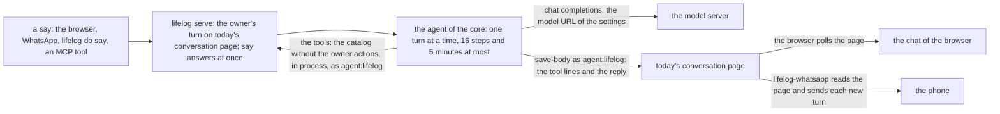

# 162 — The simple architecture: one home for each thing, and the agent in the core

> Dated implementation record. Tests use temporary folders and synthetic data. The owner's live `life.db` is never
> opened by a test.

## Status

- **Date / baseline:** 2026-10-31, `cf5d373` (master), after [plan 161](161-the-browser-as-an-extension.md).
- **Priority:** P2. **Effort:** XL, in three waves. **Risk:** LOW for the file: nothing of `schema.sql` changes.
  MEDIUM for ring 2: the agent moves into `lifelog serve`, and every handler gets one admission step. The status of
  this plan is in [the index](README.md).

## Context

The owner (2026-10-31): "Let's brainstorm on how we can make the architecture more simpler and straightforward and
more maintainable."

Five scouts (Opus) read the repo, each through one lens: what a maintainer must learn, ring 2, rings 0 and 1 with
their tests, `extensions/web`, and the contract of an extension with the process. A critic checked their claims in
the code and ranked the moves. The cost of maintenance is mostly not in the code of the core:

| where the cost is | the evidence (at `cf5d373`) |
|---|---|
| copies kept by hand | Four lists copy the 28 actions of the catalog: the README table, the class map (20 names), the hint list (15) and the MCP list (7). About 10 places outside its folder name an extension; CI does not run `extensions/ticktick`, which runs live. |
| two mechanisms for one thing | The handshake of a connected app is written twice (`cmd/lifelog/with.go` and `lifelogtest`), and the copies differ. The owner check and the read of the fields are written three times (`mount`, `appFields`, `taskWrite`). Web embeds a second time what the core embeds. Two exit codes (78 and 3) mean "the owner acts first". |
| tests | The baseline takes 58 s, and `tests/` takes 45 s of it. About 590 lines of ring-1 tests repeat claims that `tests/` holds with mutants. `extensions/web` has 9969 test lines for 2431 lines of code. |
| records | About 19000 lines of records against about 3400 lines of contract. 29 plans are IN REVIEW. |

The scouts also found defects:

- Six actions take an unknown name or a multipart body and answer 200: `snapshot`, `integrity`, `rebuild-search`,
  `resync-links`, `revive` and `retract`. API.md says 422, and AGENTS.md says "refused, never ignored".
- CI does not run `extensions/ticktick`.
- `lifelog-gphotos` starts with no `LIFELOG_URL`; the contract of an extension says that it refuses.
- `lifelogtest.Connect` takes a catalog that `serve` refuses (it checks no class).
- Stale lines: AGENTS.md says that the first connector lives in another repo; `deploy/README.md` builds 5 of the 7
  programs; a comment of `lifelog-ticktick` says that it exits 2, and it exits 78; the index gave plan 158 a status
  that its file did not have.

The chat has one more defect, of design: the agent lives in `lifelog-whatsapp`. So the chat of the browser gets no
reply when WhatsApp does not run.

## The decisions (the owner's answers, 2026-10-31)

| subject | decision |
|---|---|
| the task pages | They stay in the core ([plan 158](158-one-task-service-behind-tasks.md)). Only the clean-up of Part G. |
| the agent | **The agent runs in `lifelog serve`.** The core holds its settings and its loop. `lifelog-whatsapp` is only a transport. |
| what starts a turn | Only `say`, on every surface. Text that `save-body` adds is an edit, never a turn. |
| the reply | `say` answers at once. The core writes the reply on the conversation page when the model is done. A client reads the page. |
| the terminal mode | `lifelog-whatsapp --terminal` is deleted. The chat of the browser and `lifelog do say` do the same. |
| the writer of the agent | `agent:lifelog`, whatever the surface. The turn keeps its `via`. |
| the README table "Every action on every surface" | It is generated: `lifelog actions --human` prints it. The table and its test leave the README. The rule of parity stays. |
| CI | It loops over `extensions/*/`. A new extension needs no CI edit. |
| the shell of an extension | One exit code for "the owner acts first": 78. The package `app` gets `Main` and `API`. |
| clean-ups | Delete the HEIF reader, the clearing of the old cookie `lifelog_token` in web, and the counts kept by hand in `tests/README.md` with their two rules in AGENTS.md. The stale worktrees are removed (done 2026-10-31). |
| the records | The index is the one home of the status of a plan. A plan is DONE when it is live. The 29 plans IN REVIEW close now. |

## Part A — one admission step and one handshake (ring 2)

1. `admit(r, row)` in `internal/api` is the one opening of every action: it reads the writer and refuses a writer
   that is not the owner for an owner row; it reads the fields with `fieldsOf` when the row has no file field; it
   parses a numeric `{id}`. `mount`, the forward to an app and `taskWrite` call it. The 21 openings of the handlers,
   `idForm`, `appFields` and the opening of `taskWrite` are deleted. `add-file` and `set-cover` keep `parseFileForm`.
   Test first: the six actions above refuse an unknown name (422) and a multipart body (415).
2. The second check of the catalog options in `internal/core` is deleted (`SearchOrderOf`, the kind of
   `SearchOptions.where` and of `RandomThing`): `fieldsOf` holds it once.
3. `(*api.Apps).Register(ctx, name, base)` is the one handshake: `GET /actions` with the class `actions`, then the
   title from `GET /`, or the lists from `GET /lists` for the class `tasks`. `probeCatalog` keeps only its loop and its
   log line. `lifelogtest.Connect` calls `Register` for both roles, and `ConnectTasks` is deleted. `Set`, `SetTasks`,
   `TaskListsOf`, `TaskList` and `Names` are no longer exported. `api.New` is folded into `NewWith`.

Done: the six refusals pass; a test of `lifelogtest` shows that a catalog with no class `actions` is refused, as
`serve` refuses it.

## Part B — the agent in the core

1. A new package `internal/agent` (ring 2: it dispatches the catalog) holds the loop, the tools and the instructions
   from `extensions/whatsapp/agent`, and the client of the model from `extensions/whatsapp/model`. The client of the
   model is the one dial of the core to a host that is not its own: the file is named in `remoteAllowed`, and the
   boundary test `TestTheCoreDialsOnlyItsServer` names it as the exception. The core still never writes the name of a
   vendor: the protocol is "chat completions" (`thirdParties` has `openai`).
2. `say` writes the owner's turn, answers at once, and gives the turn to the agent. The agent runs one turn at a time,
   with a queue of 32, at most 16 model steps and 5 minutes for a turn. `serve` owns its goroutine: it starts with the
   listener, ends on the interrupt before the drain, and is awaited. A turn that the stop cuts writes nothing more.
3. The tools are the catalog without the owner actions and without a file field, as today. The agent runs them in
   process through the handler as `agent:lifelog`, so the server holds the owner rule. The reply and the tool lines go
   to the page with `save-body` as `agent:lifelog`, in the form of the conversation class of API.md.
4. The settings stay in the core (`model_url`, `model`, `model_key`, `owner_number`). The agent reads them at each turn,
   in process. With no model set, the reply is one line: "No model is set: open Settings."
5. `lifelog-whatsapp` becomes the transport. A message of the owner's number becomes `say` with `via=whatsapp`. It reads
   today's conversation page, and it sends to the phone each new turn that did not come from WhatsApp: the replies,
   and the owner's turns from another surface, marked "You wrote in lifelog:". It keeps the login, the filter of the
   owner's number and its state folder. `agent/`, `model/`, `terminal/` and `--terminal` are deleted.
6. The temporary server of `lifelog NAME` runs the agent too, so `lifelog web` and `lifelog whatsapp` by hand get
   replies.
7. The docs: the README decision "the core calls no model" is written again; AGENTS.md (the rings and the boundary
   tests), API.md (`say` and the conversation class), `extensions/README.md` and the README of whatsapp.

Done: an end-to-end test of the core: a `say` with a fake model server (an `httptest` server in the test) gets its
reply on the page, written as `agent:lifelog`, and a tool call of an owner action is refused. The chat test of web gets
a reply with no WhatsApp. The end-to-end test of whatsapp: a message of the fake chat becomes a `say`, and the reply
reaches the fake chat. The live move ships `lifelog` and `lifelog-whatsapp` together.

## Part C — `extensions/web`: one copy of each thing

1. Web reads the embedded entities of the core and does not embed them again: `embedLinks`, `core.entity`,
   `embedWriter` and the second read of `draw` are deleted. The day page reads the core 3 times, not 8.
2. One copy of each thing that the ports of plan 161 doubled: `jsonShape` and the type assertions of `view.Props`;
   `localPath` (use `isPath`); one helper for a whole page in the tests (four today); one table of the install files;
   the form options `pattern` and `group`, which no template uses; the lines of port history ("Core test:", "ported").
3. The clearing of the old cookie `lifelog_token` is deleted.

Done: `cd extensions/web && go test ./...` passes; a test counts the reads of the core for the day page.

## Part D — the tests

1. The title fuzz of `tests/wikilinks_test.go` runs 6000 strings, not 60000; a Go fuzz target `FuzzTitlePredicate`
   holds the long run. The 3661 days of `tests/streak_test.go` are one bulk insert with a label.
2. The core tests that probe the DDL that `tests/` holds with mutants are deleted (the list is in the report of the
   critic: `TestLinkFieldsImmutable`, the `execRefused` block, the raw `ON CONFLICT` loop, five integrity tests).
   `TestPragmasAndReaders` stays: it holds the connection settings of production.
3. The hand lists become rules that the tests read from the catalog: the class of each action, the title of a create
   (it starts with New or Add), a hint on each POST row, and a floor of two names in the MCP test.
4. The parity rows of `cmd/lifelog/parity_test.go` keep what a surface adapts: each CLI shortcut, the file field, the
   word `today`, a flag, a number, the refusals 422, 409 and 403, the owner and the agent, a GET and a POST, one row for
   each kind of field. The rows that only send one more action through the generic `do` are deleted.
5. The counts in `tests/README.md` (the mutants, the diagrams) and their two rules in AGENTS.md are deleted.

Done: all 284 mutants are still killed; the baseline is faster, with the time before and after in the report.

## Part E — the docs: one home for each rule

1. Each decision of README.md says the decision and its reason in one to three sentences, with a link to the home of
   the behaviour. The rules of the wire that API.md holds, and a test keeps true, are not written again: the
   owner-only refusal (18 times in 5 pages today) and the form of the conversation (4 homes). The rings are drawn once,
   in AGENTS.md.
2. The table "Every action on every surface" and `TestTheTableOfTheSurfacesIsTheCatalog` leave the README. One
   paragraph gives the rule: the route is the href in `GET /actions`, the CLI line is `do NAME`, the MCP tool is NAME
   with `_` in place of `-`, and an owner action has no tool. `lifelog actions --human` prints each action with these
   and with its owner mark and its shortcut. A test holds that each shortcut names an action. The rule of AGENTS.md
   "Every capability on every surface" points to `lifelog actions` in place of the table.
3. The stale lines of the Context are corrected.

## Part F — the shell of an extension

1. 78 is the one code for "the owner acts first": `lifelog-whatsapp` exits 78 where it exits 3 today, and `serve`
   takes only 78.
2. The package `app` gets `Main(name, run)` (the signal context, the line `lifelog-NAME: err`, the exit code: 0, 78 for
   `app.OwnerActs`, else 1) and `API(url, source)` (it refuses an empty URL with one sentence, and reads
   `LIFELOG_TOKEN`). The five programs use them: the two `exitCode` types, the four refusals of the URL, the reads of
   the token, `--token-file` of whatsapp and `LIFELOG_WEB_STATE` are deleted. `lifelog-gphotos` then refuses a missing
   `LIFELOG_URL`.

## Part G — CI, the build line and the tasks

1. `.github/workflows/baseline.yml` loops over `extensions/*/` and skips a folder with no `go.mod`; the cache takes
   `**/go.sum`. README.md and `deploy/README.md` give one build line for every extension:
   `for d in extensions/*/; do go build -C "$d" -o <install folder>/ ./cmd/...; done`.
2. The tasks: one table of the six task actions (`taskWrites` and `isTaskAction` are deleted), the options of
   `add-task` set once for each request, no clone of six rows for each task, and one copy of the entity helper of a
   service (`app.Entity`, in place of the copies in ticktick and in the test service).

## Part H — the HEIF reader

The HEIF reader of `internal/photo`, its kit and its tests are deleted (about 470 lines). A HEIC upload takes the day of
the request. Preview cannot draw a HEIC today.

## Part I — the records

The index is the one home of the status of a plan; a plan file holds the record (dates, commits, checks), not the
status word. A plan is DONE when it is live. The 29 plans IN REVIEW are DONE in the index now. `docs/process.md` says
so.

## Execution

Sonnet sub-agents build each part in a worktree. The main session briefs, merges and runs the checks. Opus 5.5 does the
counter-review. The waves keep the scopes apart:

| wave | parts | why this order |
|---|---|---|
| 1 | A (`internal/api`, `cmd/lifelog/with.go`, `lifelogtest`), C (`extensions/web`), H (`internal/photo`), I (`docs/plans`), D1 and D2 (`tests/`, the tests of `internal/core`) | No two parts share a file. |
| 2 | B (`internal/agent`, `cmd/lifelog`, the `say` of `internal/api`, `extensions/whatsapp`), G2 (`internal/api/tasks.go`, `app`, ticktick) | B needs the admission of A. G2 and B share no file. |
| 3 | F (`app`, the five programs), G1 (CI, the build line), D3 to D5 (the tests of `internal/api` and `cmd/lifelog`), E (the pages) | F touches the main of whatsapp after B. E says what the code says at the end. |

## Checks

- Each wave: `gofmt`; at the root `go vet ./... && go test ./...`, `go test -count=1 -shuffle=on ./...`, `staticcheck
  ./...`, `govulncheck ./...`; the race check for `internal/api`, `internal/agent` and `cmd/lifelog`; each extension
  `go vet ./... && go test ./...` and `go mod tidy -diff`.
- The time of the baseline before and after Part D, on the same machine.
- Live: Part B ships `lifelog` and `lifelog-whatsapp` together; the report names the install paths, the restart and the
  log lines. A reply in the chat of the browser with WhatsApp stopped is the check of the owner.
- Linux only. Windows is not tested.
