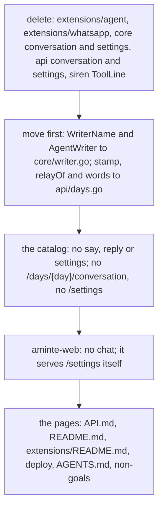

# 163 — One way for an agent: the CLI and the MCP server

> Dated implementation record. Tests use temporary folders and synthetic data. The owner's live `life.db` is never
> opened by a test.

## Status

- **Date / baseline:** 2026-11-09, `7bc13da` (master).
- **Priority:** P2. **Effort:** L. **Risk:** LOW for the file: nothing of `schema.sql` changes. MEDIUM for the
  browser: its Settings page no longer reads the core. The status of this plan is in [the index](README.md).

## Context

The owner (2026-11-09) wants one way for an AI agent to work with `aminte`: through the CLI and the MCP server
([issue 0093](../issues/0093-three-ways-for-an-agent.md), [RFC 0026](../rfcs/0026-no-agent-inside-and-no-whatsapp.md)).
The internal agent (`aminte-agent`), the WhatsApp transport (`aminte-whatsapp`) and the conversation in the core go.

"Agent" in the core is a writer class (`agent:NAME`), not `aminte-agent`. It stays: the owner-only rule refuses an
agent the owner's actions, and an agent's capture names it with `via NAME`.

The owner's decisions (2026-11-09): `aminte-web` serves its own Settings page; the `Conversation YYYY-MM-DD` pages of
the owner's file are tombstoned after the ship; the change is shipped to the service.

## The change

- `client/tools.Of` loses its argument `keep`: only the agent passed one.
- `insertPage` was `insertRow` plus the two conversation checks, so it is gone and its callers call `insertRow`.
- `.gitignore` keeps `*.settings.json`: an old settings file beside `life.db` may still hold a model key.

## Done when

- The catalog, `aminte actions --human` and the MCP tool list have no `say`, `reply` or `settings`.
- The browser has no chat, and `/settings` shows "This browser" and the backup.
- `go vet ./... && go test ./...` passes at the root and in each extension.
- The service runs with `--with web` and no `agent` or `whatsapp` child, and the conversation pages of the owner's file
  are tombstoned.

## Record

Filled in when it is live.
