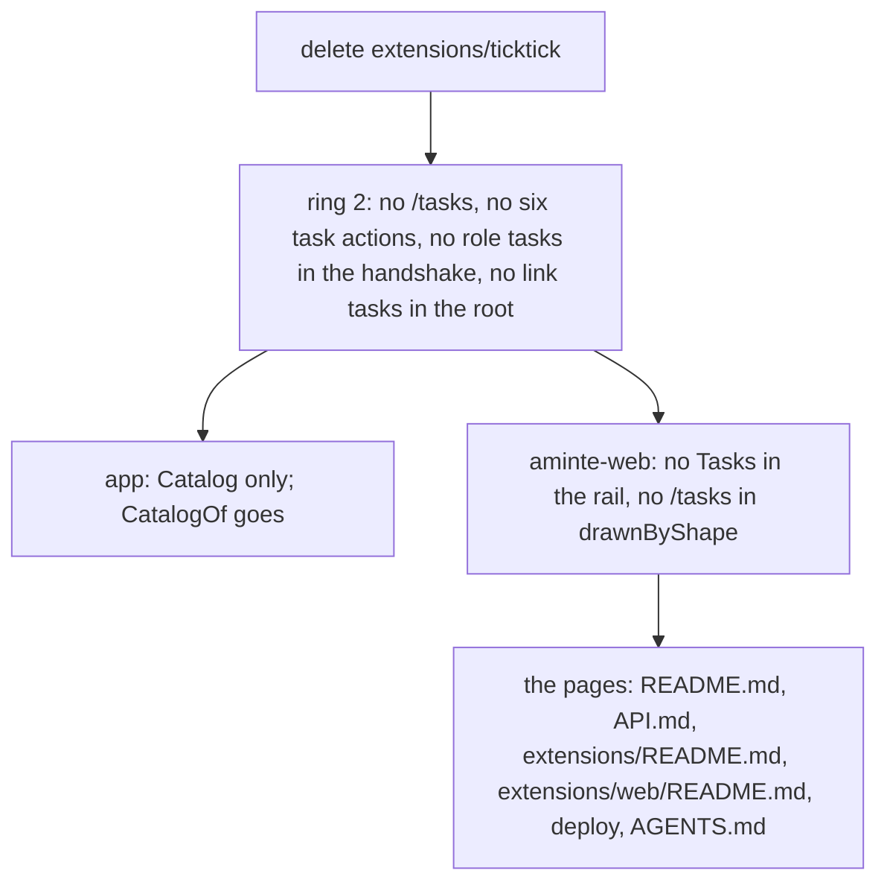

# 164 — No task service: TickTick and Tasks go

> Dated implementation record. Tests use temporary folders and synthetic data. The owner's live `life.db` is never
> opened by a test.

## Status

- **Date / baseline:** 2026-11-09, `066ce18` (master).
- **Priority:** P2. **Effort:** M. **Risk:** LOW for the file: nothing of `schema.sql` changes, and `docs/` never named
  the task service. LOW for ring 2: code goes, and nothing new comes.
- **Checks (2026-11-09, Linux, Go 1.27.3):** root `go vet ./... && go test ./...` and `go test -count=1 -shuffle=on
  ./...` passed; `go vet ./... && go test ./...` passed in `extensions/web`, `extensions/mcp`, `extensions/agentic`
  and `extensions/googlephotos`. `icons.png` was drawn again with `go run ./tools/pixelart`. Not run: `staticcheck`
  and `govulncheck` (not installed). Not shipped.

## Context

The owner (2026-11-09): "I want to get rid of the tasks integration with ticktick, or at least refine it and make it
better and more consistent. Right now my gf checked a task on our shared list, which was due 4 times before hand and
it saved everything in today note. I don't want for every small task to append to daily note."

The cause: `aminte-ticktick` wrote one `Done:` capture for each completion. The key was the task id and
`completedTime`. A repeating task ticked once for each overdue occurrence is four completions, so it wrote four
lines. A shared list counts as the owner's list, and the Open API of TickTick does not say who completed a task.

The owner chose, out of three options (stop the Done lines; Done lines from named lists only; remove TickTick
entirely), to **remove TickTick entirely**. TickTick was the one task service, so the task service of ring 2
(plan 158) goes with it: there is nothing left to serve. D23 holds as before: a plan lives in the app the owner plans
in, and the file keeps no task.

## The change

- The `Done:` entries that are in the owner's file stay. The file keeps what was written ([D11](../decisions/D11-tombstones.md)),
  and the owner removes a line by hand when they want to.
- `ticktick` stays in the list of third parties of `boundary_test.go`: the core still never names it.
- The `tasks` pixel icon of `aminte-web` goes if no other entry uses it.
- Plans 155 to 158 are dated records and do not change.

## Ship

The service unit runs `--with ticktick`. Before the new `aminte` is installed, the owner removes `--with ticktick`
from the unit. Otherwise `serve` cannot find `aminte-ticktick`. The installed `aminte-ticktick` and
`~/.config/aminte-ticktick/` may then be deleted.

## Done when

- `extensions/ticktick` does not exist, and no Go source or page of the repo, outside `docs/plans`, `docs/issues`,
  `docs/rfcs` and the third-party list of `boundary_test.go`, names TickTick or the task service.
- `GET /tasks` is 404, the catalog has no `*-task` action and no `sync-tasks`, and the root has no link `tasks`.
- `go vet ./... && go test ./...` passes at the root and in `extensions/web`, `extensions/mcp`, `extensions/agentic`
  and `extensions/googlephotos`.
