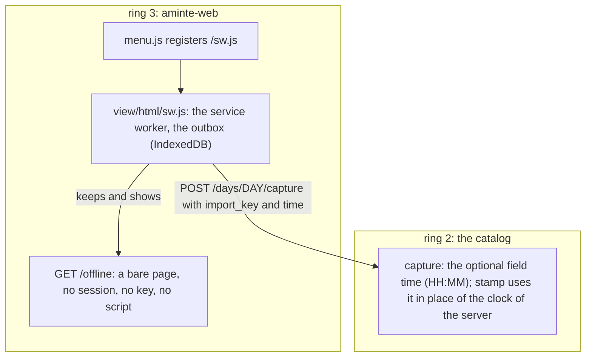

# 165 — The journal takes an entry while the server is asleep

> Dated implementation record. Tests use temporary folders and synthetic data. The owner's live `life.db` is never
> opened by a test.

## Status

- **Date / baseline:** 2026-11-12, `6153686` (master). [Issue 0094](../issues/0094-the-journal-is-closed-while-the-server-is-asleep.md).
- **Priority:** P2. **Effort:** M. **Risk:** LOW for the file: nothing of `schema.sql` changes, and no decision of
  `docs/` changes. MEDIUM for the browser: the service worker answers every navigation, and no Go test runs it.
- **Checks:** see [the checks](#checks) and [the check by hand](#the-check-by-hand). The service worker ran in a
  headless Firefox; no phone and no other engine yet.
- **Live:** 2026-11-12, 13:21, at `e5c6f8e` ([the ship](#ship)). Not yet seen on a phone.

## Context

The owner (2026-11-12): "I closed the tablet ( this os ) on which aminte is running and I wanted to add some text to
the daily journal. The problem was that it was offline and could not access the app. I want to be able to access the
app even when it is offline ( as a PWA or something ) and when it connects back to sync with the master database."

The server is the owner's own machine. It was asleep, so the browser on another device got no answer and the entry was
not written.

"Sync" here is an outbox of new journal entries in the browser. It is not a second copy of `life.db` and not a merge:
the [non-goals](../architecture/non-goals.md) exclude those. [D3](../decisions/D03-integer-ids.md) already allows this
design: a device that is offline queues only new rows and replays them through the API, each with an `import_key`.
[D28](../decisions/D28-capture-keys.md) already makes a capture that is sent again a no-op.

## The decisions (the owner's answers, 2026-11-12)

| subject | decision |
|---|---|
| what the app does offline | **Write only.** An offline page with the entry form and the list of the entries that wait. Nothing of `life.db` is kept on the other device. The `no-store` rule and the lock stay as they are. |
| the time of an entry that is sent late | **A new optional field on `capture`.** The entry shows the time it was written, not the time it arrived. |

The decisions that the plan made, and the owner approved with the plan:

| subject | decision |
|---|---|
| the field | `time`, of the type `time`: `HH:MM` in 24 hours, on the clock of the writer and on the day of the path. `at` means a UTC instant elsewhere in the API. |
| a value that is not a clock | 422, nothing written (`24:00`, `7:5`, `7:05`, `21:40:00`). A `time` with a mood and no text is 422. A time later than now is accepted: the server does not know the zone of the device. |
| the capture form of the day | It hides `time` and sends it empty. The field is on `/actions?new=capture`, in the CLI's `do` and in the MCP tool, through the catalog. |
| the offline form | Text only. It is a second capture form, against "one form for one thing"; the owner's word above covers it. |
| the lock | `/offline` shows the words of the entries that wait without the PIN. The server cannot lock a page that it does not serve. |
| when the outbox is sent | At the next navigation that the server answers. No Background Sync: one engine only. |
| an edit of a body offline | Not included. `save-body` needs the current version, and a late save can conflict. |

## The change

The flow of the worker, and each rule with its reason, are in
[extensions/web/README.md](../../extensions/web/README.md#offline): that page is their home.

Ring 2 (`internal/api`):

- `catalog.go`: `capture` lists `time`. `request.go`: `clock` reads a field of the type `time` and refuses a value that
  is not `HH:MM`. `days.go`: `stamp` takes the time that the writer sent.
- The shape of the value is a rule of the API, not of the data: the time of an entry is text at the start of the body
  ([D5](../decisions/D05-pages-and-day-pages.md)), so no CHECK can hold it.
- `API.md`: the type `time`, and the field in the class `day`.

Ring 3 (`extensions/web`):

- `view/html/sw.js` (new), `view/html/offline.html` (new), two lines in `view/html/menu.js`, `"hide" "time"` in
  `view/html/day.html`.
- `web/assets.go`: `/sw.js` in `staticFiles` as an install file, `GET /offline`, both with `Cache-Control: no-cache`.
  `web/door.go`: `/offline` needs no session (`needsNoSession`).

Tests:

- `internal/api/days_test.go`: `TestACaptureKeepsTheTimeItWasWritten`, `TestACaptureRefusesATimeThatIsNotAClock`,
  `TestACaptureWithATimeSentAgainIsAddedOnce`. The first and the third failed before the change, for the reason that
  the field did not exist.
- `extensions/web/web/offline_test.go` (new): `TestTheOfflinePageNeedsNoSessionAndHoldsNoKey`,
  `TestWhatTheWorkerReadsFromACapture`, `TestTheCaptureFormOfTheDayHidesTheTime`.
- `extensions/web/web/files_test.go`: `/sw.js` in `ownFiles` and in the ten `installFiles`;
  `TestTheScriptsNameWhatTheyDo` holds the words of `sw.js` and that it names each start address of the manifest.
  `web_test.go`: `TestTheScriptsAreSmallAndAlone` has a limit for each file (`sw.js` under 200 lines, no other script
  loaded).
- `extensions/web/e2e_test.go`: the real `aminte` and the real `aminte-web` serve the two files with no session, and an
  entry that is sent late, two times, is stored one time on its day with its time.

## The check by hand

No Go test runs the worker: it runs in a browser only, and a browser driver would be a new dependency. The check uses a
database in a temporary folder, never the owner's file.

1. Build `aminte` and `aminte-web` into one temporary folder. Run `aminte init` on a new file there, and
   `aminte --db FILE serve --addr 127.0.0.1:PORT --token-file F --with web` with `AMINTE_WEB_LISTEN`,
   `AMINTE_WEB_ORIGINS` and `XDG_CONFIG_HOME` set for that folder.
2. Log in. Open Home, so the worker installs. Add an entry: it lands on Home (the worker is in the path of the write).
3. Stop the two processes with `SIGSTOP`: they give no answer, as on a machine that is asleep. Add an entry on Home.
   Expected, after 8 seconds: `/offline`, with "1 entry waits", the words, the day and the time. Add a second entry on
   `/offline`.
4. Continue the processes with `SIGCONT`. Use "Try again". Expected: Home with the two entries. The core holds each
   entry one time, with the time it was written. More navigations add nothing.
5. Stop the server. Add an entry on Home: `/offline` shows at once. Start the server again: the session is gone, so
   "Try again" goes to the login. After the login the entry is in the journal one time.
6. With the lock on: lock the browser, and check that an entry that waits stays until the PIN opens the session.

**The run of 2026-11-12** (Linux, Firefox 159.0.1, headless, driven by a script of the session that is not in the
repo). Steps 1 to 5 passed:

- The worker installed and controlled the page. An entry online landed on Home through the worker.
- Asleep: the capture of Home showed `/offline` after 8.2 seconds with "1 entry waits", its words, the day and the
  time. The form of `/offline` kept a second entry. A navigation to Home showed the offline page after 8.1 seconds.
- Awake: "Try again" sent the outbox, and Home showed the two entries. The core held each entry one time, with the time
  it was written. Two more navigations added nothing.
- A capture for a day that is no day waited, was refused after the wake, showed on `/offline` with its words, did not
  block Home, and went with Remove.
- Down: the capture showed `/offline` after 0.2 seconds, and any other address showed the offline page. After the new
  start the entry was in the journal one time.

What the run did not show:

- The session was still valid after the new start of the server, so the 401 path did not run in the browser.
  `TestWhatTheWorkerReadsFromACapture` holds the answers of the server for it.
- Step 6 (the lock) did not run in the browser.
- The log of the pages had errors that are not of this change: the content scripts of a browser extension of the
  machine, fonts that did not load on a page with no session or with no server (the page then uses the fallback faces),
  and the browser's own check of `/sw.js` while the server was down.
- Chromium, Safari and a phone were not tested.

## Ship

Needs the owner's word (given on 2026-11-12: "do all three", "and push"). `aminte` and `aminte-web` ship together
([deploy/README.md](../../deploy/README.md#ship-a-change)). On the owner's machine the installed programs are built from
a pinned commit of this repository, so the ship is a push of `master` and an update of that pin; the service then
starts again with the new programs. After it, open the app one time on each device while the server is up: the worker
installs at that visit, and the offline page works only after it.

**The record of the ship (2026-11-12).** `master` was pushed at `e5c6f8e`, and the owner pushed the new pin. The
machine of the server built its system and started the service again at 13:21.

- The installed programs: `aminte` and `aminte-web` of the build `aminte-0.1.0-e5c6f8e`, in one folder.
- The log of the service: `aminte: serving ... (token required) (version 0.1.0, user_version 1)`,
  `aminte: with web: started (pid 57175)`, `aminte-web: ... the browser is on http://127.0.0.1:7780`,
  `aminte: with web: a catalog of 1 actions on 127.0.0.1:36235`.
- On the door of the live service, with no session: `GET /sw.js` is 200, `text/javascript`, `no-cache`;
  `GET /offline` is 200, `no-cache`, with the mark of the outbox one time; `GET /assets/menu.js` is 401, as before.
- Not checked: the offline mode on a phone, against the live service.

## Checks

2026-11-12, Linux, Go 1.27.2 (the toolchain of `go.mod`).

- `gofmt -l .`: no file.
- Root: `go vet ./... && go test ./...`, and `go test -count=1 -shuffle=on ./...`.
- `extensions/web` and `extensions/mcp`: `go vet ./... && go test ./...`.
- `node --check` on `sw.js` and `menu.js`: the syntax only.
- The check by hand, steps 1 to 5, in a headless Firefox (above).
- Not run: step 6 of the check by hand; a phone, Chromium and Safari; `staticcheck` and `govulncheck` (not installed);
  Windows; the race detector.

## Done when

- A capture with `time` begins with that time, on every surface, and a value that is not `HH:MM` is 422.
- With the worker installed, an entry that is written while the server gives no answer is in the journal one time, on
  its day and with its time, after the next navigation that the server answers.
- `/offline` and `/sw.js` answer with no session and hold nothing of the life log; every other answer of a session
  stays `no-store`.
- The check by hand passed in a browser, and the change is live. Then issue 0094 is resolved.
