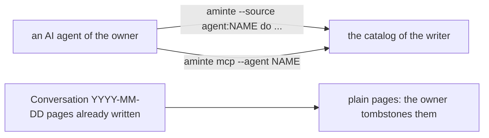

# 0026 — No agent inside and no WhatsApp: an agent talks to aminte through the CLI and the MCP server

- **Date:** 2026-11-09
- **Status:** accepted
- **Answers:** [0093](../issues/0093-three-ways-for-an-agent.md)

## Problem

Three ways lead an agent to `life.db`: the MCP server and the CLI, the chat of the browser with `aminte-agent`, and
WhatsApp with `aminte-whatsapp` and `aminte-agent`. The second and the third keep a conversation in the core (a format
of turns, a reserved title and category, the actions `say`, `reply` and `settings`), a chat in the browser, a model
endpoint and a pairing with a phone. The owner will build one agent outside, on the CLI and the MCP server.

## Options

**A. Keep all three.** No work now. The core keeps the rules of a conversation that only the two extensions use.

**B. Remove WhatsApp only.** The chat of the browser and `aminte-agent` stay, so the conversation stays in the core.

**C. Remove the conversation, `aminte-agent` and `aminte-whatsapp`.**

- Removed from the core: the actions `say`, `reply` and `settings`; `GET /days/{day}/conversation` and
  `GET /settings`; the reserved title `Conversation YYYY-MM-DD` and the reserved category `Conversations`; the refusal
  of an agent's write of the body of a conversation page; the settings file beside `life.db`; `siren.ToolLine`; the
  root's embedded `conversation`.
- Removed from `aminte-web`: the chat column, the conversation view and its script. The Settings page stays: the
  browser serves it, with its own settings and the backup.
- Removed: the modules `extensions/agent` and `extensions/whatsapp`.
- Kept: the writer class `agent:NAME`, the owner-only rule, `aminte mcp --agent NAME`, `aminte agentic-init`, the
  package `client/tools`, and the stamp `(HH:MM, via NAME)` of a capture that an agent sends.
- Nothing in the schema changes: a conversation was a plain page filed by `part-of` in `Conversations`.
- Lost: a chat in the browser and on the phone.

## Recommendation

Option C, as the owner decided on 2026-11-09.

## Validation

`go vet ./... && go test ./...` passes at the root and in each extension. The catalog has no `say`, `reply` or
`settings`; the MCP tool list has neither. No suite of `tests/` changes: the schema is the same.

## Outcome

Accepted 2026-11-09, option C, as the owner decided. No decision changes. The [non-goals](../architecture/non-goals.md)
row of a model inside the writer cites this proposal too.
