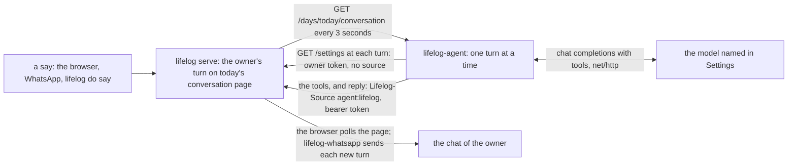

# lifelog-agent

`lifelog-agent` answers the owner in the conversation of lifelog. The owner says something on a surface that has the
action `say`: the browser, WhatsApp or `lifelog do say`. (`say` is an owner action, so it is not an MCP tool.) The agent
reads the conversation page, calls a model, and writes the answer with the action `reply`. The model reads and writes
`life.db` through the action catalog of the API, as the [MCP server](../mcp/README.md) offers it.

It is a client of the lifelog HTTP API ([API.md](../../API.md)). It is a separate Go module, `lifelog-agent`. It
imports `lifelog/siren`, `lifelog/client` and `lifelog/client/tools` of the root module (a `replace` directive), and
nothing of `lifelog/internal`. The core calls no model: this program is the only one that does. It writes as
`agent:lifelog`. The API refuses the owner-only actions to such a writer.



## How it works

- **The page is the truth.** The agent keeps no file. Every 3 seconds it reads today's conversation. When the last turn
  of the page is the owner's, nobody has answered it: that is a turn of the agent. After a restart the agent answers a
  page that waits, and it does not answer a page that it answered. The core owns the convention of the page (the
  title, the category, the first line, the paragraph of a turn: see the conversation class in
  [API.md](../../API.md#conversation)). The agent holds no title and no category.
- **The core writes both turns.** `say` writes the turn of the owner. `reply` writes the turn of the agent. An agent
  cannot save the body of a conversation page: the core refuses it (403), and the agent writes with `reply`. The core
  stamps the turn, puts it in the right place, makes the lines of the words safe (a line that reads as a turn marker is
  escaped, and a code fence that the words leave open is closed), and writes the page in one transaction. So a reply
  cannot hide the next turn from the parse of the page, and the agent does not answer its own reply. Text that an edit
  adds after a reply is part of that reply, and an edit of an old turn changes nothing.
- **One turn at a time.** A turn has at most 16 model steps and 5 minutes. The model reads the whole page of the day.
  The agent writes the tool lines and the reply in one `reply` request, so the page has the whole answer or none. The
  request has the fields `day`, `turn`, `text` and `tools`. `turn` is the number of the last owner turn that the model
  read, counted from 1 over the owner turns of the page. `tools` holds the tool lines, one for each line.
- **The owner may write while the model works.** The core puts the reply right after the owner turn that it answers. A
  turn that the owner says meanwhile stays after the reply, so it is the last turn of the page, and the next look
  answers it. An edit of an earlier turn, or text that an edit adds, moves nothing.
- **A reply that is refused or fails is not run again.** A new run of the model would repeat the tool calls of the first
  run. The core refuses a reply to a turn that has a reply already (409): the turn is answered, so the agent logs one
  line and does not run the model for it again. A reply that fails in another way is logged once. In both cases the
  agent keeps in memory the page that it read, and it answers again only when the page changes or the agent restarts.
- **One agent for one file.** Do not run `lifelog agent` by hand while `lifelog serve --with agent` runs on the same
  file. The core refuses the second reply to a turn (409), but both models run, and both make their tool calls.
- **A turn before midnight is answered on its own page.** On its first look and on each new day, the agent reads the
  day before too. A turn that waits there is answered there. The page of the new day is not made by the agent.
- **The tools are the catalog, read at each turn.** The agent reads `GET /actions` at the start of each turn and builds
  the tools of the model from it, without the owner-only actions, without `reply` (the agent writes the turn, not the
  model) and without an action that has a file field. An app that `lifelog serve --with` connects can register after the
  agent started. Its tools are there at the next turn. A read that fails keeps the tools of the last read and writes one
  line in the log.
- **No file.** An action with a file field (`add-file`, `set-cover`) is not a tool of the model. Its value would be the
  path of any file the process can read, and the model acts on text that any surface wrote to the page.
- **The model is set in lifelog.** The agent reads `GET /settings` at the start of each turn, through a second client:
  the owner's token and no `Lifelog-Source`. Every other request, the tools of the model too, carries
  `Lifelog-Source: agent:lifelog`, so the model's own `get /settings` is refused (403): the key of the model never
  reaches the model or the page. A change in Settings is seen at the next turn. With no model set, the reply of the turn
  is one line, "No model is set: open Settings." The agent keeps running.
- **A reply only.** The agent sends nothing on its own.
- **Earlier days** are pages. The model reads them with `get` on `/days/YYYY-MM-DD/conversation`.

## Build

```
go build -o lifelog-agent ./cmd/lifelog-agent
```

From the repository root: `go build -C extensions/agent -o ../../lifelog-agent ./cmd/lifelog-agent`. Put `lifelog-agent`
beside `lifelog`. The build needs no cgo.

## Run

The way to run it always is the server: `lifelog serve --with agent` (for the service: `lifelog serve --token-file F
--with agent`). The server starts `lifelog-agent` beside itself with its own address and token, and keeps it running. See
"Run by serve" in [extensions/README.md](../README.md). The agent takes no argument then: the settings of lifelog hold
everything.

| line | what happens |
|---|---|
| `lifelog agent [--db FILE]` | A try by hand. `lifelog` serves the file on a temporary loopback server for it ([extensions/README.md](../README.md)). |
| `lifelog-agent --url URL` | The same against a running `lifelog serve` at `URL` (default `$LIFELOG_URL`). `$LIFELOG_TOKEN` is the bearer token. With no URL, it refuses: a guessed address could be the server of another file. |

`--source` is not a flag: the agent always writes as `agent:lifelog`.

The model is not set here. Set it on the Settings page of lifelog (`/settings`), or with
`lifelog do settings model_url=http://HOST/v1 model=ID model_key=KEY`. `model_url` is the base URL of a server that
speaks the OpenAI chat-completions protocol, ending in `/v1`. `model` is the model id. `model_key` is a bearer
credential for the model server, and it is optional. The settings are in a file beside `life.db` (mode 0600). The key
is never a flag, never an environment variable and never in a log line.

The agent needs no state folder. It makes no file.

## Exit codes

| code | meaning |
|---|---|
| 0 | An interrupt or SIGTERM. `serve` does not start it again. |
| 1 | An error, for example a catalog that cannot be read. `serve` starts it again after 10 seconds. |
| 2 | A crash (the Go runtime ends a program that panics with 2). `serve` starts it again after 10 seconds. |
| 78 | The catalog has no `say` or no `reply`: the server is too old, or it is not a lifelog server. The owner acts first. `serve` does not start it again. |

## No unit of its own

The agent has no service unit. The unit of `lifelog serve` carries `--with agent`
([`deploy/lifelog.service`](../../deploy/lifelog.service)). The model comes from the Settings of lifelog.

## Privacy

- The text of the conversation, and the text of the pages that the model reads, go to the model server that the owner
  sets in Settings. A hosted model sees them.
- The conversation pages are in `life.db`, so every snapshot of it holds them.
- A model writes with no approval step. Its rows carry `agent:lifelog`. Nothing is ever deleted.

## Tests

`go vet ./... && go test ./...` in this folder. The tests of `agent/` run on a fake catalog and a fake model: they
hold the turns, the page, the replies and the days. The fake API keeps the rules of the real one that the agent depends
on (where `reply` puts a turn, its 404, 409 and 422, the escape of a marker line, and the 403 of `save-body` on a
conversation page). `e2e_test.go` builds the real `lifelog` and `lifelog-agent` into one folder and runs
`lifelog serve --token-file F --with agent` on a new file, with a fake model server. It says as the owner with
`lifelog do say`, and reads the page back through the API. A `say` gets its reply on the page, a tool call of an owner
action is refused, and with no model set the reply is the one line. A say with a code fence that it does not close, and
a model reply with a line of the form of an owner turn, each get one reply, and no more. It needs the `go` command and
the sources of the repository.
