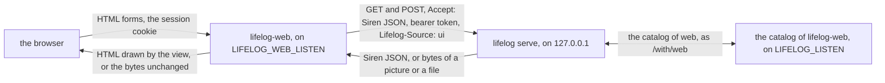
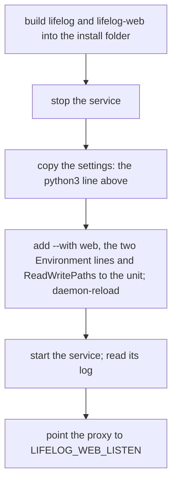
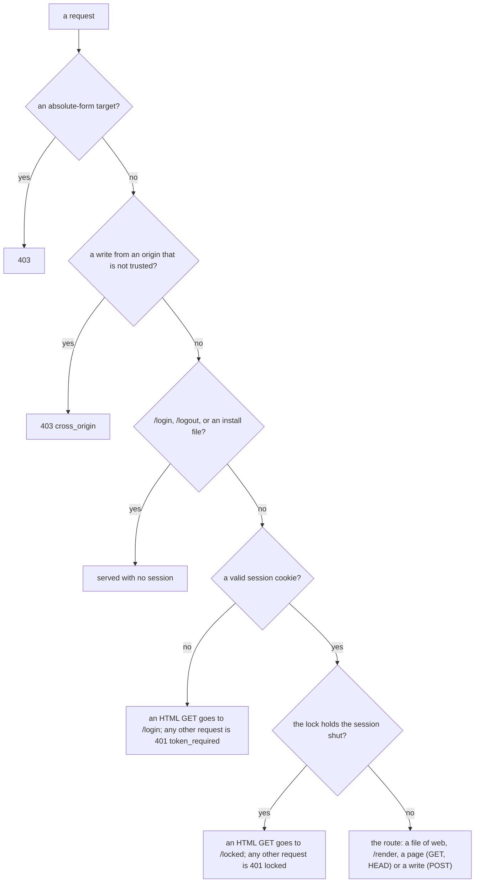
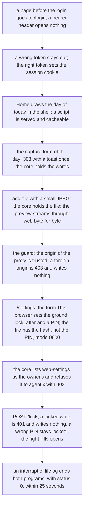

# lifelog-web: the browser

`lifelog-web` is the browser of `lifelog`. It draws the answers of the API as pages of HTML, serves the sheets, the
scripts, the fonts and the pictures of the pages, and streams a picture or a file of the core to the browser. It takes
the forms of the pages and sends the writes to the core. It is the door of the browser: the login and the lock are here.
It is an extension: a client of [API.md](../../API.md) in its own module, `lifelog-web`. It imports `lifelog/siren`,
`lifelog/client`, `lifelog/app` and `lifelog/text` of the root module (a `replace` directive), and `lifelog/lifelogtest`
in its tests. It opens no file of the life log and keeps no data of it.

A person who wants no browser does not run it. A person who wants another interface writes it against API.md alone.



## The state of this part

This part is the whole of the browser, and it runs beside the browser that is still in the core. The pages (the read
side), the forms (the write side), the login, the lock and the settings of the browser are here. The test side by side
(`web/sidebyside_test.go` for the pages, `web/forms_sidebyside_test.go` for the forms) shows a browser the same pages
from both. The differences that these tests allow are named in [the differences](#the-differences-from-the-browser-of-the-core).
The end-to-end test (`e2e_test.go`) runs this program under the real `lifelog serve --public --with web`, and the parity
test (`web/parity_test.go`) shows that each action of `GET /actions` has its form ([tests](#tests)).

Not yet done: the move of the service ([run it live](#run-it-live)). Until then the core keeps its browser, and its form
of the settings still has `ground`, `lock_after` and the PIN. Web ignores them: web keeps its own.

## Build and run

From this folder, build the program beside `lifelog`, so that `lifelog` finds it:

```
go build -o <the folder of lifelog>/lifelog-web ./cmd/lifelog-web
```

Run it as a child of the server, which gives it the address of the server and the token:

```
lifelog serve --public --with web
```

or, for a trial on a `life.db` that exists, as `lifelog web`. `lifelog` then opens a server for the life of the program.
A trial needs `LIFELOG_TOKEN` in the environment: any token of 32 characters or more. It is the login of the browser,
and the temporary server of the core checks no token.

| environment | meaning |
|---|---|
| `LIFELOG_URL` | The address of the core, `http://127.0.0.1:PORT`. Required: the program refuses to start without it, with exit status 2, so `serve` does not start it again. |
| `LIFELOG_TOKEN` | The owner's token, the same as the token of the core. Required, 32 characters or more, one line. It is the login of the browser and the bearer token of every request to the core. A new token ends every session of every browser. |
| `LIFELOG_WEB_LISTEN` | The address of the door of the browser. A loopback address only (`127.0.0.1:7780` by default). Another address is refused with exit status 2. The proxy of the owner points to it and ends TLS. |
| `LIFELOG_WEB_ORIGINS` | The browser origins that the guard of the writes trusts besides its own, separated by commas or spaces: `https://lifelog.example`. Each is a scheme, a host, an optional port and nothing else, in lower case. The origin that the proxy shows to the browser is the one to list: behind a proxy the `Origin` of a form is not the `Host` that web sees. |
| `LIFELOG_WEB_STATE` | The state folder. The default is `os.UserConfigDir()/lifelog-web`. The tests set it. |
| `LIFELOG_LISTEN` | Set by `serve --with` only: the loopback address where this program serves its catalog ([the settings](#the-settings-of-the-browser)). Not set: there is no catalog, and the form "This browser" is not drawn, because the core has no `web-settings` action. |

A bad value of any of these is a refusal with exit status 2: the owner acts first, and `serve` does not start the program
again. So is a settings file that cannot be read, and a state folder that cannot be made. The unit of the service lists
`~/.config/lifelog-web` in `ReadWritePaths`, else the program cannot write its settings.

### One step for the owner: copy the settings

The keys of the settings of the browser are the keys of the settings file of the core: `ground`, `lock_after` and
`lock_pin_hash`. The hash of the PIN has the same form. So one line copies the values that the owner has now, with the
service stopped. It copies these three keys only (never the key of the model), and the new file has the mode 0600:

```
python3 -c 'import json,os,sys; s=json.load(open(sys.argv[1])); o=os.path.expanduser(sys.argv[2]); os.makedirs(os.path.dirname(o),exist_ok=True); os.umask(0o077); json.dump({k:s[k] for k in ("ground","lock_after","lock_pin_hash") if s.get(k)}, open(o,"w"))' /path/to/life.settings.json ~/.config/lifelog-web/settings.json
```

## Run it live

In stage 2 the core is still `--public`, and its own browser still answers on its address, so the owner can compare the two
pages. Web is added beside it. The owner does these steps in this order:



1. Build both programs into the folder where the unit's `ExecStart` runs `lifelog`. `serve` refuses to start without
   `lifelog-web` beside `lifelog`, before the file opens.

   ```
   go build -o <install folder>/lifelog ./cmd/lifelog
   go build -C extensions/web -o <install folder>/lifelog-web ./cmd/lifelog-web
   ```

2. Stop the service, and copy the settings with [the python3 line](#one-step-for-the-owner-copy-the-settings). The new file
   is `~/.config/lifelog-web/settings.json`, with the mode 0600.
3. Change the unit. Keep the line that runs `lifelog serve --public` (its address, its `--token-file`, its `--allow-origin`)
   and add `--with web`. Add the two variables and the folder of the state:

   ```
   ExecStart=/home/OWNER/.local/bin/lifelog --db /home/OWNER/lifelog/life.db serve --public --token-file /home/OWNER/life/token --allow-origin https://lifelog.example --snapshots /home/OWNER/snapshots --with web
   Environment=LIFELOG_WEB_LISTEN=127.0.0.1:7780
   Environment=LIFELOG_WEB_ORIGINS=https://lifelog.example
   ReadWritePaths=/home/OWNER/.config/lifelog-web
   ```

   The unit has no token: `serve` reads it from the token file and gives it to web as `LIFELOG_TOKEN`. The origin in
   `LIFELOG_WEB_ORIGINS` is the one that the proxy shows to the browser; `--allow-origin` lists the same origin for the
   browser of the core. `ReadWritePaths` is needed when the unit has `ProtectHome=read-only`.
4. `systemctl daemon-reload`, then start the service. The log (`journalctl -u lifelog.service -n 30`) must show these three
   lines: `lifelog: with web: started (pid N)`, `lifelog-web: DATE TIME the browser is on http://127.0.0.1:7780` and
   `lifelog: with web: a catalog of 1 actions on 127.0.0.1:PORT`. A line `ended with status 2: not started again` means a
   bad variable: web wrote the reason to the log, and the owner acts first.
5. Point the local proxy to `LIFELOG_WEB_LISTEN` (`127.0.0.1:7780`) in place of the address of the core. The proxy ends TLS.
   The core stays on its own address for the programs: the CLI, the MCP server and the connected apps.

To go back, point the proxy to the core again and remove `--with web`. The settings of the core are unchanged: web writes
only its own file.

## What web does with a request



| request | answer |
|---|---|
| `GET /login`, `POST /login`, `POST /logout` | The login page, the login, the end of the session. See [the login and the lock](#the-login-and-the-lock). |
| `GET /manifest.webmanifest`, `/assets/icon*`, `wood.png`, `ground.png`, `embers.png`, `sprites.png`, `icons.png` | The files that a browser fetches to install the app. No session needed. |
| `GET /assets/...` (the other files), `/assets/fonts/...` | A file of the program: a sheet, a script, a font. The same type and cache headers as the core gave. A session is needed. |
| `POST /lock`, `/unlock`, `/awake`, `GET /locked` | The lock. |
| `POST /render` | The Preview of a body: a page drawn from the field `body` (or `text`). It writes nothing and asks the core for nothing. The body is 20 MiB at most. |
| any other `GET` or `HEAD` | One read of the core for the same path and query, without the receipt `feedback`. See below. |
| any other `POST` | A write: see [the write side](#the-write-side). |
| any other method | 405 `bad_request` with `Allow: GET, HEAD, POST`. |

The read of the core asks for Siren JSON, as the writer `ui`, with the request's context. The core answers one of three
things:

- **A redirect.** The browser gets the same redirect. A `Location` that is not a path of the core is a fault of the core
  (502), because it would send the browser to another host.
- **A Siren entity.** The view draws it, in the shell, with the status of the core. An entity of an error is the page of
  the error. A page of the shell takes `Speculation-Rules`. A 503 keeps the `Retry-After` of the core. A page that carries
  the receipt of a toast (`?feedback=`) draws the toast once, with `Cache-Control: no-store` and `Referrer-Policy:
  no-referrer`.
- **Any other answer** (a picture, a file, a snapshot). The body streams to the browser, with the status and the
  headers that describe it (`Content-Type`, `Content-Length`, `Content-Disposition`, `Cache-Control`, `ETag`,
  `Last-Modified`, `Accept-Ranges`, `Content-Range`, `Allow`). The `Range` and the conditional headers of the browser go
  to the core, so a browser can resume a download. The body is never held whole.

Every answer of a session but a file under `/assets/` has `Cache-Control: no-store`. A picture that the core keeps for a
year would show from the cache in a locked browser.

Three decisions come from the data of the API and from no rule that web copies:

- **Home.** `GET /` is the page of today. The root of the API names the day of today as a sub-entity, and web draws it.
- **A page with a view of its own.** The page of a live metric links to its series (rel `series`), and the page of a
  live conversation links to the conversation of its day (rel `conversation`). Web sends the browser to that view, with
  the query kept (the receipt of a toast too, which moves with the redirect), because the view carries the page.
- **The shell.** The strip of today, the days, the apps and the chat column come from `GET /?embed=today,conversation`.
  The cards of the column are one read for each of the newest six addresses of today's conversation, all at once, as the
  writer `agent:embed`, which the core refuses an owner-only read. A read that fails keeps the plain link. The
  conversation view takes its cards from `?embed=ref`, which the core makes.

A core that is down is a 503 page with `Retry-After`. A core that is slow is a 504 page. A browser that goes away ends
the request to the core. The page names no address and no cause: the log has them.

## The write side


- **The catalog is read for each urlencoded write, and not kept.** The catalog (`GET /actions`) is the one list of the
  fields of an action. Web needs it for two things: the action at the path of the write has a pick bar, and so some fields
  of a second form must be taken out; and the long-text fields (the `textarea` fields) say which text to show again on a
  page of a refusal. A kept copy could be old: the core may be a new build, and a connected app may have come or gone. A
  write is rare and the read is on the loopback, so one more small request costs less than a rule for when to forget. A
  form with no field, and a form of a file, read no catalog.
- **A form of a file streams.** It goes to the core unchanged, and web holds none of it. So web cannot read `back` in the
  body of such a form. The view puts it in the query of the address of the form instead
  (`/pages/12/cover?back=%2Fpages%2F12`), and web reads it there and does not send it on. A text form has `back` in its
  body, as it had in the core.
- **The pick bar.** The pick bar of a list posts the form of `file-pages` to `tombstone-pages` by a second button
  (`view.SharedForms`). Web sends the action only the fields that it lists, and takes the others of the shared form out.
  A field that neither form lists stays, and the core refuses it (422).
- **The return.** A write that succeeds returns the browser to the page it came from (`back`, when it is a path of this
  server) or to the written thing, and the result of the write is the toast on that page. So a reload never posts again.
  A `back` that is not a path is ignored, not refused: the write is done.
- **The guard.** A write from an origin that is not trusted is refused before anything else (403 `cross_origin`): the
  browser's own `Sec-Fetch-Site` and `Origin` headers, with `LIFELOG_WEB_ORIGINS` for the origin of the proxy.
- **No retry.** Web sends a write once. A write that was sent may be done.

## The login and the lock

The login is the login of the public listener of the core, moved here ([plan 160](../../docs/plans/160-the-lock.md)).

- `POST /login` with the token sets the cookie `lifelog_session`: 16 random bytes and the HMAC-SHA256 of them, `HttpOnly`,
  `SameSite=Strict`, for one year. The key of the HMAC is derived from the token in the way of the core, so a cookie of the
  browser of the core is valid here. A wrong token goes back to the form, and the log has one line and not the token.
- The cookie is not `Secure`. The core marks it `Secure` when it serves TLS itself. This program serves plain HTTP on the
  loopback, and the proxy ends TLS. If the owner wants the mark, the proxy can set it.
- A browser with no valid cookie gets `/login` for an HTML `GET`, and 401 `token_required` for any other request. **Web takes
  no bearer header.** A program uses the API of the core, and a bearer header opens nothing here, so it is no way round the
  lock.
- The sessions are in memory. A restart of the program locks every session when the lock is on: the PIN opens it again.
- The lock closes a session that is idle for longer than `lock_after` plus one minute, and `POST /lock` closes it at once.
  The rules, with their reasons, are in plan 160 and in its counter-review: a try is counted before the PIN is compared;
  five wrong PINs end the session; a lock keeps the count of wrong PINs; an ended session compares no PIN; the lock page
  keeps the path of the page and never its query; the old cookie `lifelog_token` is cleared by any request that carries it.
- A navigation that is not a prefetch or a prerender, a form post and `POST /awake` are the owner's activity. A script's
  fetch, the poll of the chat and a speculative load are not.

## The settings of the browser

The ground (`boards`, `oak`, `firelight` or `embers`) and the lock (`lock_after`, the PIN) are the settings of the
browser. They are in `settings.json` in the state folder, with the keys `ground`, `lock_after` and `lock_pin_hash`. The file
has mode 0600 and holds a salted PBKDF2 hash of the PIN, never the PIN. A write makes a temporary file in the same folder,
syncs it and renames it, so a reader never sees half a file.

This program is the only writer of the file. It reads the file at the start and keeps the settings in memory. A request
reads memory, and a change is live at once. A hand edit of the file is live after the next start. A file that cannot be
read stops the start: the core read the file at each request and locked a session when it could not, and here there is no
read that can fail while the program runs.

With `LIFELOG_LISTEN`, the program serves a catalog on that address, and `lifelog serve --with web` merges it into its own:

| route | answer |
|---|---|
| `GET /actions` | The one action `settings` (the core names it `web-settings`): `POST /settings` with the fields `ground`, `lock_after` and `pin` (a password). `owner: true`, so the core refuses it to an `agent:*` or `import:*` writer and calls this program only for the owner. |
| `GET /` | The home, titled "This browser": the settings as properties, and the action with its values. It has no PIN and no hash. |
| `POST /settings` | Saves. A field that is left out stays. An empty field clears that setting, but an empty `pin` keeps the stored PIN. An unknown field, a value outside the options, a PIN that is not 4 to 8 digits, and `lock_after` with no PIN are 422, and nothing is written. The answer is the home, with the result "Settings saved.". |

The page `/settings` is the settings page of the core, and under its form a second form, "This browser": the action
`web-settings` of the catalog of the core, with the values of this program. It posts to web, which sends it to the core,
which sends it on to this catalog. Without the app (no `LIFELOG_LISTEN`) the form is not drawn.

## The differences from the browser of the core

The side-by-side tests allow these differences, and no other:

| difference | reason |
|---|---|
| `Vary: Accept` is not sent. | The core answers one address as JSON or as HTML. Web answers HTML only. |
| `Cache-Control: no-store` on a page. | Every answer of a session but a file under `/assets/` is `no-store` (the lock). The local handler of the core sets none for a page. |
| `Content-Length` of a short page. | A real connection adds it; the recorder of the core's side has none. |
| The key of a form and the receipt of a toast. | They are random. The tests replace each by one word on both sides. |
| The time of a row that the test made. | The database stamps it with its own wall clock, and two files are made at two moments. |
| A form of a file has `back` in the query of its address. | Web streams the body of a file and does not read it. |
| A refused form of a file does not show "What you sent". | The text is in the body, which web does not read. |
| The settings page has the form "This browser". | The core of the test has no app web, so the page is the same there; with the app, the form is under the form of the core. The form of the core still has `ground`, `lock_after` and the PIN. |
| A text field of a connected app can be shown again on an error page. | The `textarea` fields come from the whole catalog, with the apps. The core used its own fields only. |
| No CORS answers, and no bearer door. | Web is the door of a browser. Another origin or a program uses the API of the core. |

## The scripts

A page of the shell carries its sheets and these scripts, each a `script` element with `defer`:

- `/assets/chat.js` on every page of the shell. It helps the chat column and gives the focus back to the ⋯ button.
- `/assets/lock.js` only when the lock is on. It sends `POST /awake` when the owner is active, and clears the screen when
  the owner is idle.

Each script is small (under 80 lines), has no framework and needs no build step. **Every form works without them**: a
form posts and the answer redirects, a menu and a dialog open with HTML alone. A script is a convenience, and the rule
that the owner gave in 2026-10-14 is that the browser does what HTML can do, even at the cost of a small convenience.
`TestTheScriptsAreSmallAndAlone` holds the count and the size.

## Layout

| path | what |
|---|---|
| `cmd/lifelog-web` | The program: the environment, the loopback door, the catalog, the drain on an interrupt. |
| `web` | The handler: `web.New(web.Options{...})`. `web.go` the options and the routes; `door.go` the checks of every request, the login and the logout; `sessions.go` the sessions and their cookie; `lock.go` the lock; `page.go` the read; `write.go` the write; `feedback.go` the toast; `shell.go` the shell; `assets.go` the files and `/render`; `settings.go` the file of the settings and the PIN; `catalog.go` the catalog of this program. |
| `view` | A copy of the view of the core: the templates, the sheets, the scripts, the fonts, the pictures. Stage 3 of [plan 161](../../docs/plans/161-the-browser-as-an-extension.md) deletes the one in the core, and this copy is then the only one. Two changes of the copy: a form of a file puts `back` in the query of its address (`formView.ActionHref`), and the settings page draws the form "This browser". |
| `pixelart` | A copy of the drawings that the pictures of the view are tested against. |
| `internal/formdoc` | Reads the forms of a page of HTML as a browser reads them. Only the tests import it. |
| `e2e_test.go` | The end-to-end test against the real `lifelog serve --with web` ([tests](#tests)). |

## Tests

```
go vet ./... && go test ./...
```

in this folder. A test of `web` uses `lifelog/lifelogtest`: a real core handler over a fresh synthetic file, in the
process, and `Server.Connect` to register the catalog of web as the app `web`, as `serve --with web` does. No test opens the
owner's `life.db`.

The tests of the login and the lock are the tests of the public listener of the core, ported with their cases and their
assertions (`web/door_test.go`; each test says which test of the core it is). The tests of the feedback receipts are those of
the core (`web/feedback_internal_test.go`), the tests of the PIN too (`web/settings_internal_test.go`), and the tests of the
settings are the settings part of the core's `TestLockSettings` (`web/catalog_test.go`). A test of the write side
(`web/write_test.go`) holds the requests that reach the core, the stream of a file, and the answers that a real core does not
give.

**The parity test** (`web/parity_test.go`). Web holds its own parity: the API and the CLI are held in the core, and the MCP
server by its own end-to-end test. The test reads `GET /actions` of the core with the app `web` connected. For each action it
asks web for `/actions` (for an action with a path field, `/actions?new=NAME&FIELD=VALUE` with a synthetic value, as the pages
link to it) and reads the forms of the HTML as a browser reads them. The page must hold a form with the method and the address
of the action. No action is exempt. The test fails for an action without a form and for a path field with no synthetic value.

**The end-to-end test** (`e2e_test.go`). It builds the real `lifelog` and `lifelog-web` into one folder, makes a synthetic
`life.db` there, and starts the line of [the live unit](#run-it-live): `lifelog serve --public --addr 127.0.0.1:0
--token-file F --with web`, with `LIFELOG_WEB_LISTEN`, `LIFELOG_WEB_ORIGINS` (its own origin and one proxy origin) and
`LIFELOG_WEB_STATE` set. Then it is a browser on the door of web alone: a cookie jar, `Accept: text/html`, and the fetch
headers of a navigation. It checks, in order:



It reads the stored state back through the API of the core with the bearer token, and it never trusts a page for what the file
holds. Every wait polls a fact (a line of the log, a port, an exit) with a deadline. The test needs `go` and the sources of
`lifelog` two folders up, else it is skipped; `-short` and Windows skip it too. It reads the clock of the real core, so a run
that crosses midnight can fail once.
