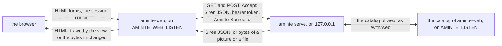
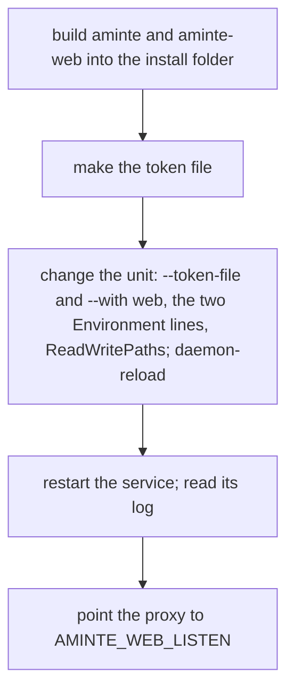
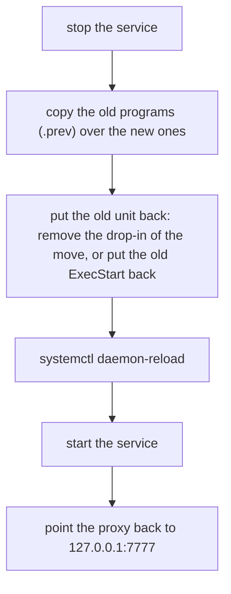
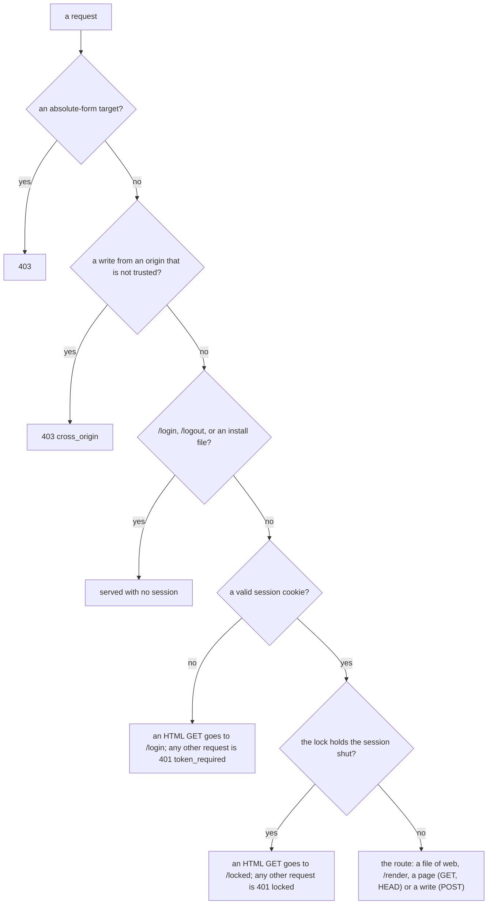
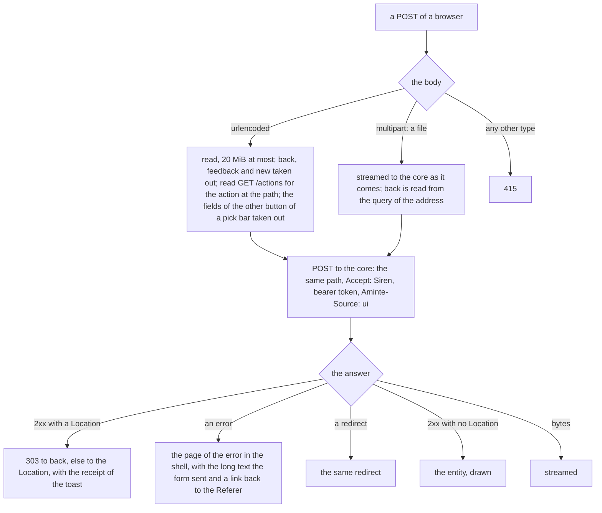
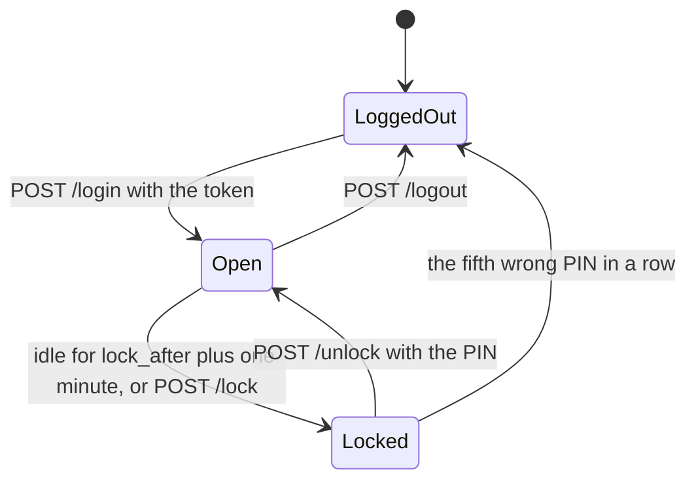
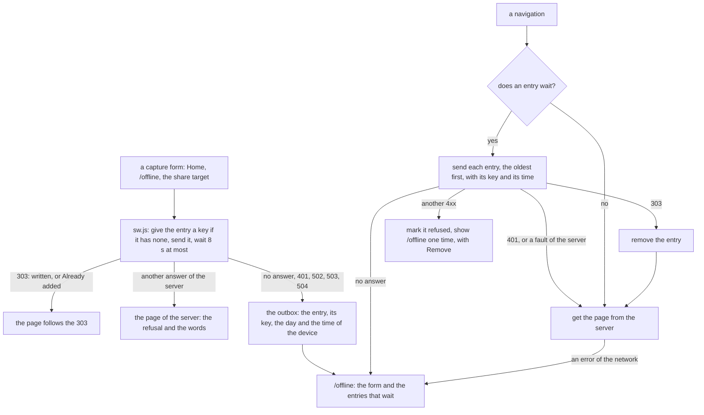
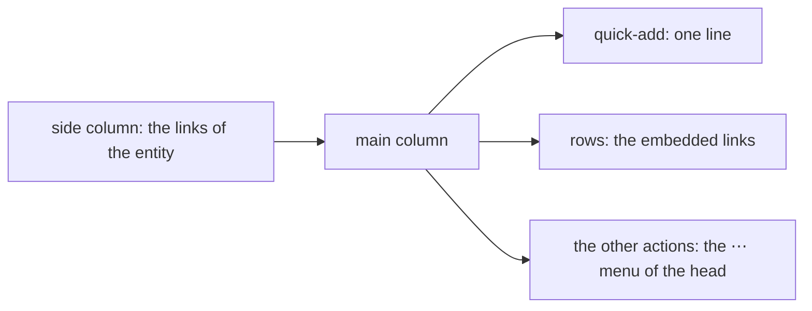

# aminte-web: the browser

`aminte-web` is the browser of `aminte`. It draws the answers of the API as pages of HTML, serves the sheets, the
scripts, the fonts and the pictures of the pages, and streams a picture or a file of the core to the browser. It takes
the forms of the pages and sends the writes to the core. It is the door of the browser: the login and the lock are here.
It is an extension: a client of [API.md](../../API.md) in its own module, `aminte-web`. It imports `aminte/siren`,
`aminte/client`, `aminte/app` and `aminte/text` of the root module (a `replace` directive), and `aminte/amintetest`
in its tests. It opens no file of the life log and keeps no data of it.

It is the only browser of `aminte`. The core answers Siren JSON and bytes, and it holds no HTML, no CSS, no JavaScript
and no picture of a page. The decisions of the browser are in this page, as the decisions of an extension live in its
README ([plan 161](../../docs/plans/161-the-browser-as-an-extension.md)).

A person who wants no browser does not run it. A person who wants another interface writes it against API.md alone.



## What is here

This program is the whole of the browser. The pages (the read side), the forms (the write side), the login, the lock and
the settings of the browser are here. The end-to-end test (`e2e_test.go`) runs this program under the real
`aminte serve --token-file F --with web`. The parity test (`web/parity_test.go`) shows that each action of
`GET /actions` has its form ([tests](#tests)).

## Build and run

From this folder, build the program beside `aminte`, so that `aminte` finds it:

```
go build -o <the folder of aminte>/aminte-web ./cmd/aminte-web
```

Run it as a child of the server, which gives it the address of the server and the token:

```
aminte serve --token-file F --with web
```

or, for a trial on a `life.db` that exists, as `aminte web`. `aminte` then opens a temporary server for the life of the
program. That server checks no token. The program still needs `AMINTE_TOKEN` in the environment for its login: any token
of 32 characters or more, in one line, that does not start or end with a space or a tab.

| environment | meaning |
|---|---|
| `AMINTE_URL` | The address of the core, `http://127.0.0.1:PORT`. Required: the program refuses to start without it, with exit status 78, so `serve` does not start it again. |
| `AMINTE_TOKEN` | The token of the server. Required, 32 characters or more, one line, and no space or tab at its start or end; without it the program exits with status 78. It is the login of the browser and the bearer token of every request to the core. `serve --with` sets it from the token of the server. A new token ends every session of every browser. |
| `AMINTE_WEB_LISTEN` | The address of the door of the browser. A loopback address only (`127.0.0.1:7780` by default). Another address is refused with exit status 78. The proxy of the owner points to it and ends TLS. |
| `AMINTE_WEB_ORIGINS` | The browser origins that the guard of the writes trusts besides its own, separated by commas or spaces: `https://aminte.example`. Each is a scheme, a host, an optional port and nothing else, in lower case. The origin that the proxy shows to the browser is the one to list: behind a proxy the `Origin` of a form is not the `Host` that web sees. |
| `AMINTE_LISTEN` | Set by `serve --with` only: the loopback address where this program serves its catalog ([the settings](#the-settings-of-the-browser)). Not set: there is no catalog, and the form "This browser" is not drawn, because the core has no `web-settings` action. |

A bad value of any of these is a refusal with exit status 78: the owner acts first, and `serve` does not start the program
again. So is a settings file that is not JSON, and a state folder that cannot be made. A settings file that cannot be read
now (a fault of the file system) ends the program with status 1, and `serve` starts it again after 10 seconds. When the
unit of the service has `ProtectHome=read-only`, it must list `~/.config/aminte-web` in `ReadWritePaths`, else the
program cannot write its settings.

## Install

The reference unit is [deploy/aminte.service](../../deploy/aminte.service), and
[deploy/README.md](../../deploy/README.md) says how to ship a change. The unit has one home: this page does not copy its
lines. The owner does these steps in this order:



1. Build both programs into the folder where the unit's `ExecStart` runs `aminte`. `serve` refuses to start without
   `aminte-web` beside `aminte`, before the file opens.

   ```
   go build -o <install folder>/aminte ./cmd/aminte
   go build -C extensions/web -o <install folder>/aminte-web ./cmd/aminte-web
   ```

2. Make the token file: one line of 32 characters or more, with no space or tab at its start or end ([the quick start](../../README.md) shows a line that makes it).
3. Change the unit. `ExecStart` runs `serve --token-file F --snapshots D --with web`. The core listens on the loopback
   only, and the token turns on its check. A unit that still has `--public`, `--allow-origin`, `--tls-cert` or
   `--tls-key` fails, because `serve` refuses a flag that it does not know. Add
   `Environment=AMINTE_WEB_LISTEN=127.0.0.1:7780`, `Environment=AMINTE_WEB_ORIGINS=` with the origin that the proxy shows
   to the browser, and the folder of the state of web in `ReadWritePaths` (needed when the unit has
   `ProtectHome=read-only`). The unit has no token: `serve` reads it from the token file and gives it to web as
   `AMINTE_TOKEN`.
4. `systemctl daemon-reload`, then restart the service. The log (`journalctl -u aminte.service -n 30`) must show these
   lines: `aminte: serving PATH on http://127.0.0.1:7777 (token required) (version V, user_version N)`,
   `aminte: with web: started (pid N)`, `aminte-web: DATE TIME the browser is on http://127.0.0.1:7780` and
   `aminte: with web: a catalog of 1 actions on 127.0.0.1:PORT`. A line `ended with status 78: not started again` means a
   bad variable: web wrote the reason to the log, and the owner acts first.
5. Point the local proxy to `AMINTE_WEB_LISTEN` (`127.0.0.1:7780`). The proxy ends TLS and maps the name on the private
   network to web alone. The core stays on its own loopback address for the programs on the machine: the CLI, the MCP
   server and the connected apps.

To go back, keep the programs of the last good build beside the new ones (for example `aminte.prev` and
`aminte-web.prev`). A step back between two builds that are both after this move is the copy of the programs over the
new ones and a restart of the service.

A step back to a build before this move needs more, because the old `aminte` refuses `--token-file` without
`--public`: the old programs with the new unit leave the service down. The old `aminte` also served the browser on
`127.0.0.1:7777`, so the proxy goes back there. Do these steps in this order:



## What web does with a request



| request | answer |
|---|---|
| `GET /login`, `POST /login`, `POST /logout` | The login page, the login, the end of the session. See [the login and the lock](#the-login-and-the-lock). |
| `GET /manifest.webmanifest`, `/assets/icon*`, `wood.png`, `ground.png`, `embers.png`, `sprites.png`, `icons.png` | The files that a browser fetches to install the app ([install as an app](#install-as-an-app)). No session needed. |
| `GET /assets/...` (the other files), `/assets/fonts/...` | A file of the program: a sheet, a script, a font, a picture ([the sheets, the faces and the pictures](#the-sheets-the-faces-and-the-pictures)). A session is needed. The files under `/assets/` are the one place with a cache; a font is cached for a year. |
| `POST /lock`, `/unlock`, `/awake`, `GET /locked` | The lock. With the lock off, `POST /lock` is 409. |
| `POST /render` | The Preview of a body: a page drawn from the field `body` (or `text`). It writes nothing and asks the core for nothing. It is not a catalog action, and it answers `text/html` only. The body is 20 MiB at most. |
| any other `GET` or `HEAD` | One read of the core for the same path and query, without `back` and `feedback`, the two names that only web reads. `new` stays: the core takes it on a read. See below. |
| any other `POST` | A write: see [the write side](#the-write-side). |
| any other method, on a path of the core | 405 `bad_request` with `Allow: GET, HEAD, POST`. |
| a method that a route of web itself does not take | 405 `bad_request`. A file that web serves (the manifest and the files of web under `/assets/`) takes `GET` and `HEAD`, so its header is `Allow: GET, HEAD`. `/render` takes `POST`, so its header is `Allow: POST`. Web answers and does not ask the core. |

None of these routes is a catalog action: `/login`, `/logout`, `/lock`, `/unlock`, `/locked`, `/awake`, `/render`, the
manifest and the files under `/assets/`. They are about one browser and not about the data, so the CLI and the MCP
server do not carry them.

The read of the core asks for Siren JSON, as the writer `ui`, with the request's context. The core answers one of three
things:

- **A redirect.** The browser gets the same redirect. A `Location` that is not a path of the core is a fault of the core
  (502), because it would send the browser to another host.
- **A Siren entity.** The view draws it, in the shell, with the status of the core. An entity of an error is the page of
  the error. A page of the shell takes `Speculation-Rules`, so Chromium draws the previous and the next page on hover
  before the click. A 503 keeps the `Retry-After` of the core. A page that carries the receipt of a toast
  (`?feedback=`) draws the toast once, with `Cache-Control: no-store` and `Referrer-Policy: no-referrer`.
  Siren says that `properties` is an object. An answer whose `properties` is a list, a string or a number is no entity:
  it is a fault of the core or of an app. The browser gets the 502 `upstream` page, and the log has one line.
- **Any other answer** (a picture, a file, a snapshot). The body streams to the browser, with the status and the
  headers that describe it (`Content-Type`, `Content-Length`, `Content-Disposition`, `Cache-Control`, `ETag`,
  `Last-Modified`, `Accept-Ranges`, `Content-Range`, `Allow`). The `Range` and the conditional headers of the browser go
  to the core, so a browser can resume a download. The body is never held whole.

Every answer of a session but a file under `/assets/` has `Cache-Control: no-store`. A picture that the core keeps for a
year would show from the cache in a locked browser. The install files and `/offline` are no answers of a session: web
serves them before it reads the cookie, and they hold nothing of the database ([offline](#offline)).

Three decisions come from the data of the API and from no rule that web copies:

- **Home.** `GET /` is the page of today. The root of the API names the day of today as a sub-entity, and web draws it.
- **A page with a view of its own.** The page of a live metric links to its series (rel `series`). Web sends the browser
  to that view, with the query kept (the receipt of a toast too, which moves with the redirect), because the view
  carries the page. The page of a deleted metric stays as it is.
- **The shell.** The strip of today, the days and the apps come from `GET /?embed=today`. A day page makes 2 reads of
  the core: the page and the root.

A core that is down is a 503 page with `Retry-After`. A core that is slow is a 504 page. A browser that goes away ends
the request to the core. The page names no address and no cause: the log has them.

A panic in a handler of web is a 500 page that says "internal error". The log has one line with the route pattern, the
panic value and the stack, and never the path. A panic with `http.ErrAbortHandler` passes through, as the standard library
means it.

## The write side



- **The catalog is read for each urlencoded write, and not kept.** The catalog (`GET /actions`) is the one list of the
  fields of an action. Web needs it for two things: the action at the path of the write has a pick bar, and so some fields
  of a second form must be taken out; and the long-text fields (the `textarea` fields) say which text to show again on a
  page of a refusal. A kept copy could be old: the core may be a new build, and a connected app may have come or gone. A
  write is rare and the read is on the loopback, so one more small request costs less than a rule for when to forget. A
  form with no field, and a form of a file, read no catalog.
- **A form of a file streams.** It goes to the core unchanged, and web holds none of it. So web cannot read `back` in the
  body of such a form. The view puts it in the query of the address of the form instead
  (`/pages/12/cover?back=%2Fpages%2F12`), and web reads it there and does not send it on. A text form has `back` in its
  body.
- **The pick bar.** The pick bar of a list posts the form of `file-pages` to `tombstone-pages` by a second button
  (`view.SharedForms`). Web sends the action only the fields that it lists, and takes the others of the shared form out.
  A field that neither form lists stays, and the core refuses it (422).
- **The return.** A write that succeeds returns the browser to the page it came from (`back`, when it is a path of this
  server) or to the written thing, and the result of the write is the toast on that page. So a reload never posts again.
  The `back` path may end in an id such as `#row-4-2`, which names the row where the page opens. A `back` that is not a
  path is ignored, not refused: the write is done. A Done button on a list returns to the list. A write whose answer has
  `self` at `/` (for example `snapshot` and `rebuild-search`) returns the browser home, with the result as the toast.
- **The toast.** The words of the toast come from the shapes of `result` in [API.md](../../API.md#the-entity). After a delete
  of one page the toast offers Undo (`revive`). After a delete of several it links to the list of the deleted pages. The
  toast is an open `dialog` in the flow of the page, which Escape and its own Close close. It stays until the next page,
  because it may name what the write did not do.
- **A refused form** is answered with the page of the error: the alert first, the text it sent, and a link Back to the
  page it came from ([plan 131](../../docs/plans/131-the-pareto-pass.md)). A form of a file shows no "What you sent",
  because the text is in the body, which web does not read.
- **The guard.** A write from an origin that is not trusted is refused before anything else (403 `cross_origin`): the
  browser's own `Sec-Fetch-Site` and `Origin` headers, with `AMINTE_WEB_ORIGINS` for the origin of the proxy.
- **No retry.** Web sends a write once. A write that was sent may be done. The one sender that sends again is the
  service worker of the browser, and only a capture with its key ([offline](#offline)).

## The login and the lock

The login and the lock follow [plan 160](../../docs/plans/160-the-lock.md). A session is in one of three states.



- `POST /login` with the token sets the cookie `aminte_session`: 16 random bytes and the HMAC-SHA256 of them, `HttpOnly`,
  `SameSite=Strict`, for one year. The cookie holds no token. The key of the HMAC is derived from the token, so a session
  cookie set before the move to this program stays valid. A new token ends every session. A wrong token goes back to the
  form, and the log has one line and not the token.
- The cookie is not `Secure`. This program serves plain HTTP on the loopback, and the proxy ends TLS. If the owner wants
  the mark, the proxy can set it.
- A browser with no valid cookie gets `/login` for an HTML `GET`, and 401 `token_required` for any other request. **Web takes
  no bearer header.** A program uses the API of the core, and a bearer header opens nothing here, so it is no way round the
  lock. There is no CORS answer either: another origin or a program uses the API of the core.
- Every answer of a session but a file under `/assets/` has `Cache-Control: no-store`.
- The sessions are in memory. A restart of the program locks every session when the lock is on: the PIN opens it again.
  A restart also gives a session 5 tries again, and so does a day with no request of that session.
- The lock closes a session that is idle for longer than `lock_after` plus one minute, and `POST /lock` closes it at once.
  A locked session gets nothing of the database. An HTML `GET` goes to `/locked?next=PATH`, which asks for the PIN, and
  any other request is 401 `locked`. `next` is the path alone: a query, such as the words of a search, would show on the
  lock page.
- `POST /unlock` with the right PIN opens the session. The fifth wrong PIN in a row ends the session, and the browser
  logs in with the token again. A try is counted before the PIN is compared, so requests sent at once or held open get no
  more tries together. A lock keeps the count of wrong PINs, and an ended session compares no PIN.
- `/lock`, `/unlock`, `/locked` and `/awake` are routes of this program beside `/login` and `/logout`. They are not
  actions of the catalog: they are about one browser, not about the data.
- A navigation that is not a prefetch or a prerender, a form post and `POST /awake` are the owner's activity. A script's
  fetch and a speculative load are not.
- The lock hides the pages, not the history of the browser. The titles of the pages that were open stay in the history
  and in the suggestions of the address bar.
- The server cannot clear a screen by itself. The script `/assets/lock.js` does it ([the scripts](#the-scripts)). The Lock
  button is in the foot of the More sheet of the rail. The sheet is part of the rail on a wide screen, so the access key
  `l` works there. On a phone the button is two taps away.

## The settings of the browser

The ground (`boards`, `oak`, `firelight` or `embers`) and the lock (`lock_after`, the PIN) are the settings of the
browser. They are in `settings.json` in the state folder, with the keys `ground`, `lock_after` and `lock_pin_hash`. The file
has mode 0600 and holds a salted PBKDF2 hash of the PIN, never the PIN. A write makes a temporary file in the same folder,
syncs it and renames it, so a reader never sees half a file.

- An empty `ground` is `boards`. Another value outside the four is 422.
- `lock_after` is `off`, `5`, `10`, `15`, `30` or `60` minutes. An empty value is `off`.
- The PIN is 4 to 8 digits, else 422. `lock_after` other than `off` with no PIN is 422.

This program is the only writer of the file. It reads the file at the start and keeps the settings in memory. A request
reads memory, and a change is live at once. A hand edit of the file is live after the next start. A file that is not JSON
stops the start (status 78), and a file that cannot be read now ends the program with status 1, so `serve` starts it
again: there is no read of the file that can fail while the program runs, so a session never meets a lock that cannot
be read.

With `AMINTE_LISTEN`, the program serves a catalog on that address, and `aminte serve --with web` merges it into its own:

| route | answer |
|---|---|
| `GET /actions` | The one action `settings` (the core names it `web-settings`): `POST /settings` with the fields `ground`, `lock_after` and `pin` (a password). `owner: true`, so the core refuses it to an `agent:*` or `import:*` writer and calls this program only for the owner. |
| `GET /` | The home, titled "This browser": the settings as properties, and the action with its values. It has no PIN and no hash. |
| `POST /settings` | Saves. A field that is left out stays. An empty field clears that setting, but an empty `pin` keeps the stored PIN. An unknown field, a value outside the options, a PIN that is not 4 to 8 digits, and `lock_after` with no PIN are 422, and nothing is written. The answer is the home, with the result "Settings saved.". |

The page `/settings` is drawn by web, because the core keeps no settings. It has the form "This browser": the action
`web-settings` of the catalog of the core, with the values of this program. It posts to web, which sends it to the core,
which sends it on to this catalog. Without the app (no `AMINTE_LISTEN`) the form is not drawn. The settings page also
links to the snapshot form under Backup ([the pages](#backup)).

## The view

The view draws an entity of the API as a page. It reads only the entity.

- **One template for each class** of entity (day, page, person, metric, search, the lists). The templates are in
  `view/html/` and are embedded. Any other class has one generic template.
- **A template reads only the properties the JSON carries and places only the actions the entity offers.** So a form
  shows where the action is legal and nowhere else.
- **A body is CommonMark** with the safe defaults of goldmark: raw HTML is omitted. Its `[[wikilinks]]` and `#tags` are
  linked.
- **The page is semantic HTML.** A field is a `label` around its input. A flag, or the options 0 and 1 in a field that the
  action does not require, is one checkbox that sends 1 or nothing. A field of 2 to 5 short options is a `fieldset` of
  radio buttons. A `pages` field with `options` is a text input with a `datalist` of those titles, so the reader can also
  type a new title. A card is an `article`, a callout an `aside`, an error a `role="alert"`, a series a `table` with a
  header row. A write's result and the search are an open or a modal `dialog`. The phone's sheet is a popover.
- **A field that the browser refuses once the owner has typed in it** (`:user-invalid`) shows the same danger edge as one
  that the server refused (`aria-invalid`). The select is the own select of the app where the browser lets a sheet draw
  it (`appearance: base-select`).
- **No id or class is generated for a template to find.** The one exception is the `id` of a `datalist`, which the `list`
  of its input names: the id of the form, or else the name of the action, then the name of the field.
- **What a template cannot know comes from the entity.** `danger` marks the button of a destructive action. `owner` marks
  an owner-only one. `rows` is the height of a textarea. `options` are the choices of a field. `pages` marks a field whose
  value is the title of a page. The `code` of an error gives its first words. So no view decides any of them by the name
  of an action or of a field.
- **A page that web draws itself** (the login, the lock, an error of web) is not in the shell. It has no sidebar, so it
  shows nothing of the database.

## The pages

### Home and the day

- The margin of Home (the page of today) holds the list of the newest day pages. The root of the API carries it as
  `recent` ([plan 129](../../docs/plans/129-the-ux-pass.md)).
- A day and Home are a calendar leaf, a sheet and its margin ([plan 095](../../docs/plans/095-the-leaf-and-its-margin.md)).
  The leaf (the month on a band, the day's number in mono) heads the page. The sheet holds what the page is for: the
  journal, then Capture. The margin holds what the page asks of the owner (the readings), and it comes after the sheet on
  a narrow screen. A page and a list use the same sheet.
- A day carries its mood and the `save-body` of its day page, so the day view edits in place. A day's reading tile is a
  metric read that day and its last value.
- A person's row starts with a round picture, its cover, else the icon of a person.

### Covers

- The cover is a square at the head of the margin of the page and of the day (first on a phone), with one link to the
  picker under it. The embed of the cover is left out of the body.
- A Browse row starts with the cover as a small square. A person's is round. The `picture` of the row gives its href.
- The calendar draws a day's cover behind its square cell, under a veil of the parchment that keeps the words readable.
- The picker (`GET /pages/{id}/cover`) draws the kept pictures as tiles. Each tile is a form of its title. The form of a
  new photo is next to them.

### The calendar and the stream

- The Calendar opens on the stream (`GET /days`): the days of the record as cards, the newest first, 30 a page, then
  Older days. A card holds up to four plain lines of the journal, the mood, the cover only (a preview is 100 to 300 KB,
  so no other picture), the people as chips, the birthdays, and three pages, then a count. A day with no day page is a
  slim card with no words.
- Days, Month and Year are the zoom of the Calendar: one row of chips, with Today. They draw the links `days`, `month` and
  `year`.
- A random thing (`random-page`) is a quiet button on the stream and on Browse.

### Search

`/search` draws Pages by title first: the pages whose title starts with the words come before the pages whose words match,
so a page is one search away by its title. Then it draws the chips of the kinds, then the hits in groups by kind, each
with its cover or the icon of its kind. The search dialog is on every page of the shell ([the scripts](#the-scripts)).

### Browse

- The category tree is one fold. It is beside the list and always open in a wide column. On a phone it is a closed fold
  above the chips, and its summary names the location. The fold opens on the path to the current branch. A category that
  has categories under it folds.
- The head of the list is the location: a line of crumbs (Browse › Family › Cousins; each is a link to that category,
  the last one plain; Everything draws none) and an `h1` that says Everything, the title of the category, Not filed, Ghost
  pages or Deleted. A category adds the link Open its page.
- The chips are the kinds of the rows (Pages, People, Media, Documents, Metrics), each with its count. Inside a category,
  All is the first chip and the default.
- Each category row of the tree has a quiet + (New page in that category). It is shown on hover or focus, and always on a
  touch screen. The foot of the tree has New category (it opens the Select bar of the pages: a page becomes a category
  when something is filed in it), beside Not filed and Deleted with its count.
- Each row shows the categories it is filed in as small muted badges (inside a category, the other categories). It has a
  quiet Move link, shown on hover or focus and always on touch. The link opens the list with Select on and that row
  checked. It is a link to the one pick bar, not a second form.
- Each kind keeps its row and its order. A person has a face, the mentions and the last day. Media are tiles, newest day
  first, with the picture a file keeps or the icon of its kind; one media kind is chosen by `media=`, and each media kind
  shows its count in words. Documents are the other files, as rows. The ghost pages and the deleted pages (`deleted=1`,
  newest deletion first) are filters of Pages. A deleted row opens its page, where Restore is.
- The pick bar says N selected. Its category box lists every category by path (Family › Cousins) and takes a new name. Its
  Move box is checked inside a category. Its main button is Move to inside a category and Add to elsewhere. Inside a
  category a further button, Remove from here, takes the checked rows out of it. The bar also deletes pages, media and
  documents. After a write the browser returns to the quiet list, with no bar open.
- A page shows its categories as badges, each with an x (`file-pages` with `from`), and + Add (`file-pages` with this
  page). A category page has one section, Filed here: the sub-categories first, then the rest by title, a type badge on
  what is not a page, and Open in Browse. Its margin's Backlinks does not list `part-of`.
- Browse in a category fills the category in its New page, and a category page offers New page here.
- A long list pages ([plan 131](../../docs/plans/131-the-pareto-pass.md)).

### Several things at once

The lists of Browse and the Metrics board act on several things the same way: Select shows the boxes, and one bar holds
the count and a button for each action the list offers. Browse offers the delete on pages, media and documents. A box is
on each row or tile, and one danger button counts the checked boxes. A CSS counter does it, with no script. After the
write the page returns to the quiet list with the count.

### Metrics

- The board at `/metrics` draws each group as a grid of cards, with a jump bar to the groups. A card is the latest value
  of a metric, its day and the line of its newest 30 readings. A card is muted when the latest reading is older than 60
  days ([plan 112](../../docs/plans/112-metrics-as-cards.md)).
- Every card has the same four lines, so the cards of a row are of one height: the name, the value (a dash and the unit
  with no reading), the line (a dashed rule with none), and a foot with the day in short words. The whole day and the
  count of readings are the title of the day ([plan 120](../../docs/plans/120-a-tidy-board.md)).
- The board folds each group and each category under it. The line of a fold says its count and the day of its newest
  reading. The link to the category is the foot of the fold.
- New metric is one form in the header of `/metrics`, and not on the page of today
  ([plan 113](../../docs/plans/113-new-metric-on-metrics.md)). It asks for a name, a unit (`kg`; a range such as `1-5` for
  a score; nothing for done or not done), a note, and Ask for it every day (a box for it on every day page; the view of
  the metric changes it). The pick bar of the board files metrics in a category, made when it is new.
- The view of a metric, `/metrics/{name}`, draws its page (the note, the categories, the links, the backlinks and the
  other actions) and its readings: Add a reading, Ask for it every day, then the readings newest first in a fold a year.
  The All readings link leads a window back to the whole.
- A reading is added on the day (the boxed Add a reading of the day) and on the readings of the metric. The New menu of
  the rail opens Reading on the page of today.

### Backup

The rail has a Snapshot link (`/actions?new=snapshot`). The toast of the answer says "Download it", and the page of the
settings links to the snapshot form under Backup.

### The rail and the apps

The rail has one entry for each link `app` of the root, that is, for each app that runs. A phone shows the apps in the
More sheet. The page of an app is drawn by [the generic view](#how-the-browser-draws-a-page-of-an-app).
The rail lists no app `web`: `/with/web` leads to `/settings`.

## The shell and the look

Every page of the API is in one shell. The shell is a sidebar with the brand and today's date, the search, New, the
sections of every day (Today, Calendar, Metrics and Browse) and the owner's links. This month is on Calendar only: the
sidebar does not draw it a second time.

- **The data of the shell.** The sidebar is the one part of a page that is not the entity of the page. It reads the clock,
  for today's date (the `now` of the root), and the Today strip (the `streak`, the `written` days and the habits with
  `done` of the day; [API.md](../../API.md#root)). The strip says "2 of 4 done" over the entry, the mood and the chips. A
  chip is a daily metric with no unit ([D31](../../docs/decisions/D31-daily-metrics.md)). Each chip is a link to the form
  that does the thing. The strip also shows the days written in a row
  ([the streak](../../docs/cookbook/streaks.md)). On a phone the strip is in the sheet.
- **The phone.** Under 900 px the layout is a phone's layout
  ([plan 093](../../docs/plans/093-words-phone-and-today.md)): a top bar (the brand, the date, Search, New), a bottom bar
  of the sections of every day and More, and the rest as a sheet over the page (`#sections`). The sheet is a popover that
  More opens. Close, Escape or a tap outside closes it, with no script.
- **Container queries.** Inside the page a layout asks the width of its column (`@container column`), and not the width of
  the screen. So a day beside an open sheet lays out as in a narrow window. The title, the leaf and the padding of the
  sheet scale with the column by `clamp()`, with no step at a breakpoint
  ([plan 108](../../docs/plans/108-the-browser-made-current.md)).
- **Writing mode.** While the entry box has the focus, the rest of the page steps back.
- **The look** is the Almanac bound in Hearthwood, the materials of the owner's Balaur design system
  ([plan 096](../../docs/plans/096-bound-in-hearthwood.md), [plan 092](../../docs/plans/092-the-app-shell.md)). The page
  is a slab of oak on a floor, centred in a frame of 1512 px on a wide screen. The sidebar and the bars of the phone are
  wood. Everything written is parchment with ink. The corners are square. The edges are 2 px, with bevels and 3 px hard
  drops, and there is no blur and no gradient (the glows of the firelight floor are the one exception).
- **The ground** under the page is the choice of the owner on the settings page ([the settings of the
  browser](#the-settings-of-the-browser)): boards, oak, firelight or embers. The last two move only when the system does
  not ask for less motion.
- **The colours.** Gold marks where the owner is and what is today. Ember is the one loud button of a screen. Teal is a
  link. Dark is the identity of the look, and light is the daylight study of the same room, by `prefers-color-scheme`.
- **The faces.** Words are in Atkinson Hyperlegible. Every day, time and number is in IBM Plex Mono. The title of a page,
  the number of the leaf and the value of a reading are in Jersey 15.
- **The tokens** are custom properties of `base.css`. A material sets its own text through aliases (`--text`,
  `--text-link`, and so on). A test holds every text pair at 4.5:1 and every edge and the focus ring at 3:1, in both themes.
- **The motions** are all off under reduced motion. A press sinks. The step to the previous or the next day moves the
  leaf and cross-fades the sheet through a cross-document view transition
  ([plan 097](../../docs/plans/097-the-almanac-reflects.md)). The search dialog and the phone's sheet enter and leave by
  `@starting-style` and a discrete transition. The top bar of the phone takes its drop once the page has scrolled under
  it, by a scroll-driven animation. The New menu and the ⋯ menu of a page hang from their buttons by anchor
  positioning, with the centred box as the fallback
  ([plan 149](../../docs/plans/149-the-browser-on-the-current-platform.md)).

Do and don't:

- Show one loud button a screen.
- Show no streak, no chain and no badge for consistency.
- Write in sentence case. Use no capitals for effect.
- Use mono for days, times and numbers only.
- Let a material set its own text through the aliases.
- Use no colour outside the one token block. Its `light-dark()` pairs are held by the contrast test at 4.5:1, with the
  APCA Lc logged beside it.
- Draw a value by its type, never by its name.
- Make every form work with no script.
- Answer a refused form with the error page: the alert first, the text it sent, and Back.
- Make every empty state name the way forward.

**One component for each part of an entity.** The title and the `prev` and `next` links are a page header. Properties are
facts and panels. Sub-entities are rows. An action with no visible field is a button. An action with fields is a button
that opens its form. An error is an alert. A write's `result` is a toast at the top of the page. One button a screen is
filled: the main write. A view can fold the optional fields of an action under "N more fields", inside the form, so a
browser sends them with no script.

**A value is drawn by its type, never by the name of its property**
([plan 093](../../docs/plans/093-words-phone-and-today.md)). A day near today is in words ("yesterday · Sun 11 Oct"). An
instant is in the clock of the server's day ("today, 09:48"), and the exact instant is kept in its `<time>` element. An
object of the generic view is facts. A write's result is in sentences by the result shapes of API.md.

## Install as an app

`GET /manifest.webmanifest` and the icons (`/assets/icon.svg`, and `/assets/icon-192.png` and `/assets/icon-512.png` for
Android) make the app installable. The manifest has two shortcuts (Today, and Add to today) and a share target that posts
shared text into Capture (`POST /days/today/capture`). The service worker `/sw.js` is for [the offline mode](#offline).

These files hold nothing of the database. A browser fetches them without its cookie, so web serves them with no session
(`GET` and `HEAD`), together with the pictures `wood.png`, `ground.png`, `embers.png`, `sprites.png` and `icons.png`. The
fonts stay behind the session.

## Offline

The journal takes an entry while the server does not answer
([plan 165](../../docs/plans/165-the-journal-while-the-server-is-asleep.md)). The server is the owner's own machine, and it
can be asleep. One service worker, `/sw.js`, holds the whole of this mode, so no page gets a script that a form needs.
The worker keeps a capture that got no answer in an outbox in the browser, and sends it again when the server answers.
This is the queue of new rows that [D3](../../docs/decisions/D03-integer-ids.md) allows. It is not a copy of `life.db`.



- **Write only**, by the owner's word (2026-11-12). The worker keeps one page, `/offline`, and the entries that wait. It
  keeps no page of the life log and no answer of a session, so the `no-store` rule and the lock hold as before. A body
  cannot be edited offline: `save-body` needs the version that the server has now.
- **One key for one entry.** The first try and each later try carry the same `import_key`, so the server writes the entry
  one time ([D28](../../docs/decisions/D28-capture-keys.md)), also when the first try was done after the wait ended. That
  first try has no `time`, so an entry that the server wrote late from it has the time of the server at that moment. The
  worker makes the key when the form has none: `/offline` has none, because one kept page would send one key for every
  entry, and the share target has none.
- **The day and the time of the writing.** An entry that is kept goes to the day of the device (the word `today` becomes
  a date at that moment), with the field `time` of `capture` ([API.md](../../API.md#day)): the journal shows the time the
  entry was written, not the time it arrived. The capture form of the day hides that field and sends it empty.
- **What the worker reads** is the status of the capture. A 303 is a write that the server did, and a session POST to
  this route gets no other redirect. A 401 is a browser with no session or a locked one: the entry waits until the login
  or the PIN. A refusal that will not pass (a 4xx that is not 401) shows as the page of the server when the owner sent the
  form, and as a refused entry on `/offline`, with its words and a Remove button, when the outbox sent it.
  `TestWhatTheWorkerReadsFromACapture` holds these answers.
- **The wait.** A capture waits 8 seconds for the server. A navigation waits 8 seconds only at the addresses that the
  installed app opens, the `start_url` and the shortcuts of the manifest (`TestTheScriptsNameWhatTheyDo` holds the two
  lists equal). Any other page has no limit in the worker, because the integrity check and a snapshot can take long: it
  shows `/offline` only when the network gives an error.
- **When the outbox is sent.** At the next navigation that the server answers: the next open of the app, or "Try again"
  on `/offline`. Nothing is sent in the background (Background Sync is in one engine only).
- **`/sw.js` and `/offline` need no session**, and a browser asks for them again each time (`Cache-Control: no-cache`).
  A browser checks the worker for a new version by itself, and a locked browser must get the correction too. `/offline`
  is the same page for every browser: it has no script, and nothing of the database. The worker gets it again after each
  Home that the server answers.
- **The outbox is in this browser only** (IndexedDB), until the entries are sent. A browser can clear the storage of a
  site, so `menu.js` asks it not to (`navigator.storage.persist()`; Firefox asks the owner one time). `/offline` shows
  the words of the entries that wait without the PIN: the server cannot lock a page that it does not serve.
- **The lock does not count the worker.** A capture that the worker sends is a fetch and not a navigation, so it is no
  activity of the owner. The page that follows it is.
- **No Go test runs the worker**: it runs in a browser only, and a browser driver would be a new dependency. The Go
  tests hold the page that it keeps and each answer that it reads (`web/offline_test.go`, the end-to-end test). The
  worker is checked by hand in a browser; plan 165 has the steps and the record of the run.

## The sheets, the faces and the pictures

The stylesheet is the own work of this application. It has two embedded sheets, three embedded faces and five embedded
pictures, and it has no vendored framework and no CDN.

- `base.css` holds the tokens and styles ordinary HTML by element: type, colour, forms, tables, buttons, a print sheet,
  light and dark. `app.css` holds only what the own vocabulary of the app needs: the shell and its components,
  `.wikilink` and `.chart`. A test keeps the names of the app out of the base sheet.
- The two sheets are one cascade in four layers: `tokens`, `base`, `components` and `utilities`. They are declared once at
  the top of `base.css` and shared by the two `style` elements. Every rule is in logical properties. A test holds both
  ([plan 108](../../docs/plans/108-the-browser-made-current.md)).
- The three faces are open fonts (SIL OFL 1.1), latin and latin-ext. They are embedded with their licences and served by
  exact name at `GET /assets/fonts/{file}` with a cache of a year. Like `/render`, the route is presentation and not in
  the catalog.
- The five pictures are the wood tile of the rail, the ground tile of the page, the sparks of the embers floor, the sprite
  sheet and the icon sheet. The package `pixelart` draws them ([plan 137](../../docs/plans/137-pixel-wood-and-the-focus-pass.md),
  [plan 138](../../docs/plans/138-pixel-art-elsewhere.md), [plan 139](../../docs/plans/139-pixel-icons.md)).
- Nothing is fetched from another host, so a page looks the same offline in fifty years.

**Rejected: a vendored classless sheet** (Simple.css, Pico). Its `aside` is a floated sidebar, and ours is a callout in
flow. Its `section` is a bordered band. Its `h2` is 2.6rem, where ours labels a section. Its tables are bordered and
zebra-striped, where ours are dense. Its form controls carry blanket margins, where ours sit two to a row. Its `body` is
a 45rem grid. To keep one, we would override most of it, and we would pin a file by hand at every change upstream.

## How the browser draws a page of an app

`aminte-web` draws the page of an app with its generic view. The view reads the shape of the entity and the `class` of
its actions ([API.md](../../API.md#action-classes)). It reads no name of an app. An app action has at most one class. The
server refuses an app that sends two, and it drops a class that `siren.ActionClasses()` does not list, so an unknown
class is the same as none. An author shapes the page with three rules. The contract of an author is
[a catalog of its own](../README.md#a-catalog-of-its-own).



1. **Quick-add.** On a page under `/with/NAME`, the first action of the entity that has the class `create`,
   writes (not a `GET`), has no path field and has exactly one required field, of the type `text`, is one line at the top of the main column: that field, the button with the
   title of the action, and the other fields folded under "More fields". The Actions section does not draw it again.
2. **Rows.** Each embedded link is a row. An embedded link may carry `properties` and `actions`
   ([API.md](../../API.md#the-entity)). An action of the row that has the class `toggle` and no field is a small round button before the
   title. Its `title` is the accessible name of the button. Any other action is a boxed form after the title.
   The scalar properties of the row (a string, a number, a boolean that is true) are chips after the title, each as
   `name: value`. A row with no properties and no actions is the link and its `rel`. A form of a row returns to the
   page it is on.
3. **Two panes.** On a wide screen the links of the entity, except `self`, are a side column beside the main column.
   The link whose path is the path of the page is marked current. On a narrow screen they are a row under the title.

**The head of a page** ([plan 159](../../docs/plans/159-the-class-of-an-action.md)). The scalar properties of the entity
itself are one quiet line under its title, the meta line, each as `name: value`. A person has the name and the dates, a
file has its type and short SHA-256, then when the page was created. An object or a list stays a panel. The head is one
template for every view but the day. The actions that no template places by name are placed by their class:

- A `create` action that is not the quick-add is a button of the head. The first is the primary one.
- An `edit` action whose one field is `title` (`rename`) is a pencil beside the title.
- Any other action is in the ⋯ menu of the head, in this order: the `edit` actions first, then the others, then the
  `danger` actions last and apart. Each item opens a dialog with the form of the action, with no script. A page with no
  such action draws no ⋯ button.
- The pencil and each button open a popover under them, with the form in it. `?new=NAME` opens any of these forms as an
  open dialog.

## The scripts

A page of the shell carries its two sheets and at most two scripts, each a `script` element with `defer`. The rule of
this application: `menu.js` is on every page of the shell, and `lock.js` is on a page only when the lock is on. The
service worker is no script of a page: `menu.js` registers it.

- `/assets/menu.js` on every page of the shell. When a dialog of the ⋯ menu closes, it gives the focus back to the ⋯ button
  (the button that opened the dialog is in a popover that is hidden again), or, for a form that the link of the page
  asked for, to its head button. It registers `/sw.js` and asks the browser to keep the storage of the site.
- `/assets/lock.js` only when the lock is on. It keeps the time of the last input of the owner in `localStorage`, shared by
  every tab. A load of the page counts as input. It sends `POST /awake` at most once in 30 seconds while the owner types,
  clicks or scrolls. When the idle time is over, it sends `POST /lock` and replaces the page with the lock page, in
  every tab. The Lock button does the same at once, and the other tabs follow at their next check. A page without the
  script stays on the screen until its next request.
- `/sw.js`, the service worker of [the offline mode](#offline). It is one file under 200 lines, and it loads no other
  script. HTML cannot keep a form that the server did not answer, so this one thing needs a script.

Each script of a page is small (under 80 lines), has no framework and needs no build step. **Every form works without
them**: a form posts and the answer redirects, a menu and a dialog open with HTML alone. A script is a convenience. The
rule that the owner gave on 2026-10-14 is that the browser does what HTML can do, even at the cost of a small convenience
([plan 108](../../docs/plans/108-the-browser-made-current.md)). With no worker (an old browser, a private window) every
form works as before, and a capture that gets no answer is the error of the browser.
`TestTheScriptsAreSmallAndAlone` holds the count and the size.

What the old scripts did ([plan 091](../../docs/plans/091-the-browser-for-daily-use.md),
[plan 094](../../docs/plans/094-the-command-list.md)), HTML does by itself:

- The **search dialog** is a `dialog` that the server draws on every page of the shell, with the search form inside: the one
  search box of the shell. The Search of the rail and of the top bar open it by their command (`commandfor`). Escape or a
  tap outside closes it (`closedby="any"`).
- The sheet of sections of a phone is a popover. The toast is an open `dialog` in the flow of the page.
- The keys are the **access keys** of the browser, with its own modifier (Alt in Chromium, Alt+Shift in Firefox, Ctrl+Alt
  on a Mac): `k` the search, `n` New, `t` Today, `c` the capture, `[` and `]` the previous and the next page, and `l` the
  Lock button when the lock is on. The footer and the dialog say so.
- A form that writes a body offers **Preview**: a second button that sends it to `POST /render` in a new tab (`formaction`,
  `formtarget`). The body shows there as its page will show it, and the form keeps its words.
- A list that deletes several rows counts the checked boxes on its button by a CSS counter.
- A page of the shell carries the `Speculation-Rules` header, so Chromium draws the previous and the next page on hover
  before the click. There is no element on the page for it, and nothing happens on another engine.

## Decisions

**Rejected: a single-page app.** A single-page app is a page of JavaScript that reads the API and draws every view in the
browser. It is rejected, for three reasons that hold for a page with no build step behind the cookie of this program:

- One renderer in Go draws every page: the pages of the API, the login, the lock, the errors and the Preview. A
  single-page app would draw some pages in the browser and the others on the server.
- Every form works with no script. A single-page app has no page that works without a script.
- A single-page app is a second implementation of every view. The tests of every view would be written again, and the
  second implementation would be kept equal to the first, or would replace it.

**Rejected: pages of the life log kept in the browser.** The offline mode writes only (the owner's word, 2026-11-12). A
kept page would show without the PIN, it could be old, and it would be a second copy of private pages outside the file.

**Dropped, by the owner's word:**

- the names after `[[`;
- the live preview as one types;
- Ctrl+Enter;
- Escape to leave a field;
- the question before the browser leaves text that was not sent;
- the second press of a danger button (a boxed danger already takes two presses, and a tombstone has Restore);
- the ranking of the command list for the actions of the page.

## Layout

| path | what |
|---|---|
| `cmd/aminte-web` | The program: the environment, the loopback door, the catalog, the drain on an interrupt. |
| `web` | The handler: `web.New(web.Options{...})`. `web.go` the options and the routes; `door.go` the checks of every request, the login and the logout; `sessions.go` the sessions and their cookie; `lock.go` the lock; `page.go` the read; `write.go` the write; `feedback.go` the toast; `shell.go` the shell; `assets.go` the files, `/offline` and `/render`; `settings.go` the file of the settings and the PIN; `catalog.go` the catalog of this program. |
| `view` | The templates, the sheets, the scripts, the fonts and the pictures of the pages. The view imports `aminte/siren`, `aminte/text` and `pixelart`, and no store (`TestTheViewImportsNoStore`). A form of a file puts `back` in the query of its address (`formView.ActionHref`), and the settings page draws the form "This browser". The OFL texts of the three fonts and `fonts/README.md` travel with `view/html/fonts`. |
| `pixelart` | The drawings of the five pictures. A test compares each picture of `view/html` with its drawing, pixel by pixel. |
| `tools/pixelart` | Writes the five pictures to `view/html/` after a change to a drawing. Run it with `go run ./tools/pixelart` in this folder; a stale file fails the comparison of `pixelart`. |
| `internal/formdoc` | Reads the forms of a page of HTML as a browser reads them. Only the tests import it. |
| `e2e_test.go` | The end-to-end test against the real `aminte serve --with web` ([tests](#tests)). |

## Tests

```
go vet ./... && go test ./...
```

in this folder. The root of the repository does not run them: its `./...` does not build this module. A test of `web` uses
`aminte/amintetest`: a real core handler over a fresh synthetic file, in the process, and `Server.Connect` to register
the catalog of web as the app `web`, as `serve --with web` does. No test opens the owner's `life.db`.

The tests are in files by subject, next to the code that they hold:

- The login, the lock and the guard of the origin are in `web/door_test.go`. The receipts of the toast are in
  `web/feedback_internal_test.go`. The PIN and the file of the settings are in `web/settings_internal_test.go`, and the
  catalog of the settings is in `web/catalog_test.go`.
- The write side (`web/write_test.go`) holds the requests that reach the core, the stream of a file, and the answers that a
  real core does not give.
- The pages have one test file for each part of them (for example the day, Browse, the metrics, search and the
  settings page). A test of a page gives the page a real core with a synthetic life, and asserts what the page
  draws and what a form sends. A page of an error holds the words of each code (`TestAnErrorCodePicksItsWords`, in
  `view/page_test.go`, for each code of `siren.Codes()`).
- The sheets, the scripts and the pictures: the contrast pairs, the layers, the names of the app out of `base.css` and the
  count of the scripts (`TestTheScriptsAreSmallAndAlone`) are held in `view` and `web`. Each picture of `view/html` is
  compared with its drawing.
- The offline mode is in `web/offline_test.go`: the page that the service worker keeps, and each answer that the worker
  reads from a capture. No Go test runs the worker itself ([offline](#offline)).
- A panic in a handler is held by a test of the recover wrapper: the 500 page, the one log line, and the pass of
  `http.ErrAbortHandler`.

**The parity test** (`web/parity_test.go`). Web holds its own parity: the API and the CLI are held in the core, and the MCP
server by its own end-to-end test. The test reads `GET /actions` of the core with the app `web` connected. For each action it
asks web for `/actions` (for an action with a path field, `/actions?new=NAME&FIELD=VALUE` with a synthetic value, as the pages
link to it) and reads the forms of the HTML as a browser reads them. The page must hold a form with the method and the address
of the action. No action is exempt. The test fails for an action without a form and for a path field with no synthetic value.

**The end-to-end test** (`e2e_test.go`). It builds the real `aminte` and `aminte-web` into one folder, makes a synthetic
`life.db` there, and starts the line of [the install](#install): `aminte serve --addr 127.0.0.1:0 --token-file F --with web`,
with `AMINTE_WEB_LISTEN` and `AMINTE_WEB_ORIGINS` (its own origin and one proxy origin) set, and `XDG_CONFIG_HOME` and `APPDATA` at a folder of the test (the state folder is `aminte-web` in it). It reads
the address of the core from the startup line of `serve`. Then it is a browser on the door of web alone: a cookie jar,
`Accept: text/html`, and the fetch headers of a navigation. It checks, in order:


It reads the stored state back through the API of the core with the bearer token, and it never trusts a page for what the file
holds. Every wait polls a fact (a line of the log, a port, an exit) with a deadline. The test needs `go` and the sources of
`aminte` two folders up, else it is skipped; `-short` and Windows skip it too. It reads the clock of the real core, so a run
that crosses midnight can fail once.
