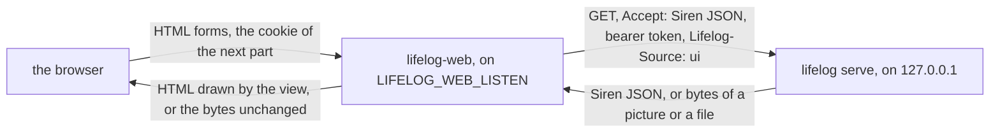

# lifelog-web: the browser

`lifelog-web` is the browser of `lifelog`. It draws the answers of the API as pages of HTML, serves the sheets, the
scripts, the fonts and the pictures of the pages, and streams a picture or a file of the core to the browser. It is an
extension: a client of [API.md](../../API.md) in its own module, `lifelog-web`. It imports `lifelog/siren`,
`lifelog/client`, `lifelog/app` and `lifelog/text` of the root module (a `replace` directive), and `lifelog/lifelogtest`
in its tests. It opens no file and keeps no data of the life log.

A person who wants no browser does not run it. A person who wants another interface writes it against API.md alone.



## The state of this part

This part is the read side, and it runs beside the browser that is still in the core. It answers `GET` and `HEAD`,
and the one `POST` that writes nothing, `/render`. The forms (a `POST` of any action), the cookie login, the lock and
the settings of the browser (`ground`, `lock_after`, the PIN) come in the next part. Until then:

- a page has the floor `boards` and no lock, and
- a `POST` to any address but `/render` is refused with 405 and `Allow: GET, HEAD`.

The test side by side (`web/sidebyside_test.go`) draws a list of pages with the browser of the core and with web, and
compares the bytes. It allows three differences and names each one.

## Build and run

From this folder, build the program beside `lifelog`, so that `lifelog` finds it:

```
go build -o <the folder of lifelog>/lifelog-web ./cmd/lifelog-web
```

Run it as a child of the server, which gives it the address of the server and the token:

```
lifelog serve --with web
```

or, for a trial on a `life.db` that exists, as `lifelog web`. `lifelog` then opens a server for the life of the program.

| environment | meaning |
|---|---|
| `LIFELOG_URL` | The address of the core, `http://127.0.0.1:PORT`. Required: the program refuses to start without it, with exit status 2, so `serve` does not start it again. |
| `LIFELOG_TOKEN` | The bearer token of the core, sent with every request. Not set: no token is sent. |
| `LIFELOG_WEB_LISTEN` | The address of the door of the browser. A loopback address only (`127.0.0.1:7780` by default). Another address is refused with exit status 2. |

The proxy of the owner points to the door. The door has no login yet, so it is on the loopback only.

## What web does with a request

| request | answer |
|---|---|
| `GET /assets/...`, `/manifest.webmanifest` | A file of the program: a sheet, a script, a picture, a font. The same type and cache headers as the core gave. |
| `POST /render` | The Preview of a body: a page drawn from the field `body` (or `text`). It writes nothing and asks the core for nothing. The body is 20 MiB at most. |
| any other `GET` or `HEAD` | One read of the core for the same path and query, without the receipt `feedback`. See below. |
| any other method | 405 `bad_request`. |

The read of the core asks for Siren JSON, as the writer `ui`, with the request's context. The core answers one of three
things:

- **A redirect.** The browser gets the same redirect. A `Location` that is not a path of the core is a fault of the core
  (502), because it would send the browser to another host.
- **A Siren entity.** The view draws it, in the shell, with the status of the core. An entity of an error is the page of
  the error. A page of the shell takes `Speculation-Rules`. A 503 keeps the `Retry-After` of the core.
- **Any other answer** (a picture, a file, a snapshot). The body streams to the browser, with the status and the
  headers that describe it (`Content-Type`, `Content-Length`, `Content-Disposition`, `Cache-Control`, `ETag`,
  `Last-Modified`, `Accept-Ranges`, `Content-Range`). The `Range` and the conditional headers of the browser go to the
  core, so a browser can resume a download. The body is never held whole.

Three decisions come from the data of the API and from no rule that web copies:

- **Home.** `GET /` is the page of today. The root of the API names the day of today as a sub-entity, and web draws it.
- **A page with a view of its own.** The page of a live metric links to its series (rel `series`), and the page of a
  live conversation links to the conversation of its day (rel `conversation`). Web sends the browser to that view, with
  the query kept, because the view carries the page.
- **The shell.** The strip of today, the days, the apps and the chat column come from `GET /?embed=today,conversation`.
  The cards of the column are one read for each of the newest six addresses of today's conversation, all at once, as the
  writer `agent:embed`, which the core refuses an owner-only read. A read that fails keeps the plain link. The
  conversation view takes its cards from `?embed=ref`, which the core makes.

A core that is down is a 503 page with `Retry-After`. A core that is slow is a 504 page. A browser that goes away ends
the request to the core. The page names no address and no cause: the log has them.

## The scripts

A page of the shell carries its sheets and these scripts, each a `script` element with `defer`:

- `/assets/chat.js` on every page of the shell. It helps the chat column and gives the focus back to the ⋯ button.
- `/assets/lock.js` only when the lock is on. It clears the screen when the owner is idle (the next part).

Each script is small (under 80 lines), has no framework and needs no build step. **Every form works without them**: a
form posts and the answer redirects, a menu and a dialog open with HTML alone. A script is a convenience, and the rule
that the owner gave in 2026-10-14 is that the browser does what HTML can do, even at the cost of a small convenience.
`TestTheScriptsAreSmallAndAlone` holds the count and the size.

## Layout

| path | what |
|---|---|
| `cmd/lifelog-web` | The program: the environment, the loopback door, the drain on an interrupt. |
| `web` | The handler: `web.New(web.Options{CoreURL, Token})`. `page.go` is the read; `shell.go` the shell; `assets.go` the files and `/render`; `settings.go` the one place where the choices of the browser are read. |
| `view` | A copy of the view of the core: the templates, the sheets, the scripts, the fonts, the pictures. Stage 3 of [plan 161](../../docs/plans/161-the-browser-as-an-extension.md) deletes the one in the core, and this copy is then the only one. |
| `pixelart` | A copy of the drawings that the pictures of the view are tested against. |

## Tests

```
go vet ./... && go test ./...
```

in this folder. A test of `web` uses `lifelog/lifelogtest`: a real core handler over a fresh synthetic file, in the
process. No test opens the owner's `life.db`.
