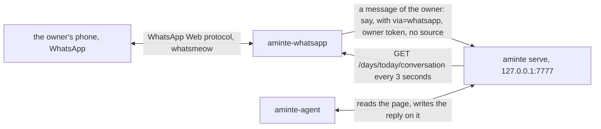

# aminte-whatsapp

`aminte-whatsapp` is the transport between WhatsApp and the conversation of aminte. The owner writes on WhatsApp,
and the message goes to the conversation page. The answer of [`aminte-agent`](../agent/README.md) comes back to the
phone. The program calls no model. If `aminte-agent` does not run, the messages still reach the page, and the
chat of the browser works as before.

It is a client of the aminte HTTP API ([API.md](../../API.md)) and a Go module of its own, `aminte-whatsapp`, as
[the contract of an extension](../README.md#what-an-extension-is) says. It writes as the owner (`say` is the owner's
action), with `via=whatsapp`.



## How it works

- **A message becomes a `say`.** A text from the owner's number goes in with the action `say` (`day` = `today`,
  `via` = `whatsapp`) as the owner's turn. `say` answers at once. The core owns the convention of the page: see the
  conversation class in [API.md](../../API.md#conversation).
- **Each new turn goes to the phone.** Every 3 seconds the program reads today's conversation. It sends to the phone
  each turn that it has not sent, except a turn that came from WhatsApp (the page names it with `via`). A reply of the
  agent goes as it is. The words that the owner said on another surface go marked "You wrote in aminte:", so the phone
  shows the same thread as the page. A turn is named by the `key` that the core gives it. An edit of a turn gives it a
  new key (see below), so a changed turn is a new turn and is sent again.
- **An edit of a turn sends that turn again.** The key of a turn comes from its words, its minute and its relay ([API.md](../../API.md#conversation)).
  When the owner edits the words of a turn on the page (a typo in the first line, a note added below a reply), the turn
  has a new key. The program has not sent that key, so it sends the turn again with its new words. A turn of the owner
  that came from WhatsApp is never sent back, also after an edit. An edit that only moves a turn (a turn removed
  above it) changes no key of that turn, and nothing is sent again. A paragraph with no marker line, added above a turn,
  is part of the turn before it. That turn gets a new key, and the program sends it again with the paragraph.
- **A reply after midnight arrives.** A turn said before midnight is answered on its own page, and the answer may come
  after midnight. The program reads the day before while its last turn is the owner's, and it sends the answer when it
  comes. A day older than yesterday is dropped.
- **One number may talk.** A message from any other number, and any group message, is logged and ignored. A photo,
  a voice note or a document from the owner gets one line: "I read text for now; send it as text." WhatsApp can deliver a
  message from a hidden id (a lid) without the number; then the sender does not match the owner's number and the
  message is logged as ignored. The log line shows the id.
- **A `say` that fails** gets one line on the phone: "I could not write your message to aminte: REASON. Say it again."
- **Messages that came while the program was off** are said once: the program says each message that is newer than the
  last message that it said, or than its start, whichever is earlier.
- **A text is cut** at 16 KiB, with a note.
- **It sends nothing on its own.** Every text on the phone is a turn of the page, a line about a message that the
  program could not take, or the one line for a photo.

## The second number

The transport is [whatsmeow](https://github.com/tulir/whatsmeow), the Go client of the unofficial WhatsApp Web
protocol. WhatsApp may ban a number that uses it, and the protocol may change. Use a number that is the second number of
aminte, never the owner's main number. The owner writes to that number from the main number.

## Build

```
go build -o aminte-whatsapp ./cmd/aminte-whatsapp
```

From the repository root: `go build -C extensions/whatsapp -o ../../aminte-whatsapp ./cmd/aminte-whatsapp`. Put
`aminte-whatsapp` beside `aminte`. The build needs no cgo.

## Run

The way to run it always is the server: `aminte serve --with whatsapp` (for the service: `aminte serve
--token-file F --with whatsapp --with agent`). The server starts `aminte-whatsapp` beside itself with its own
address and token, and keeps it running. See "Run by serve" in [extensions/README.md](../README.md). The program takes
no argument then: the settings of aminte hold everything. Run it together with `aminte-agent`: a message gets no
answer without it.

| line | what happens |
|---|---|
| `aminte whatsapp login` | Pairs the number of aminte. It draws a QR code. On that phone, open WhatsApp, Linked devices, Link a device, and scan it. After the scan it waits for the connection that finishes the pairing (up to a minute), then the session is saved and it exits. It needs nothing else. Run it once, as the user of the service, before `serve --with whatsapp`. |
| `aminte whatsapp [--db FILE]` | A try by hand: carries the messages. `aminte` serves the file on a temporary loopback server for it ([extensions/README.md](../README.md)). |
| `aminte-whatsapp --url URL` | The same against a running `aminte serve` at `URL` (default `$AMINTE_URL`; the bearer token is `$AMINTE_TOKEN`). With neither, it refuses with status 78: a guessed address could be another file's server. |

| flag | meaning |
|---|---|
| `--url` | The address of aminte. Default `$AMINTE_URL`. |

`--source` is not a flag: the program writes as the owner, because `say` is the owner's action.

**The owner's number is a setting.** Set `owner_number` on the Settings page of aminte, or with
`aminte do settings owner_number=40712345678`: the digits of the owner's phone number with the country code. The program
reads it before it connects to WhatsApp. With none set, it logs one line, `no owner number: set it in Settings
(owner_number)`, reads the settings again every 30 seconds and connects when the number is set. A number that is set is
used for the whole run: a change needs a restart (a restart of `aminte serve`, or of the line by hand). There is no
`--owner` flag.

The model is not set here, and this program does not use it. See [`aminte-agent`](../agent/README.md).

`AMINTE_URL` and `AMINTE_TOKEN` are set by `aminte whatsapp` and by `aminte serve --with whatsapp`, or by the owner.

The state folder is `os.UserConfigDir()/aminte-whatsapp/` (mode 0700). It holds `session.db` (mode 0600), the
store of the keys of the account, and `state.json`: for each day that the program watches, the key (the `key` that the
core gives it) of each turn that it has dealt with, and the time of the last message that it said. The keys are a set and
not a position, because the core puts a reply right after the turn that it answers, and that can be before a newer
turn. So each turn is sent once, wherever it stands on the page, also after an edit above it or after a delete and a
revive of the page. After each look, the keys of a day are the keys of the turns that the page has: the key of a turn
that the owner removed is dropped, so it cannot hide a new turn that gets the same key (the same words, in the same
minute, from the same relay). When an edit removes the first of two equal turns (the same minute and words), the later
one takes its key, so a new equal turn that the owner says in that window (before the next look) can be counted as sent. A page with no turns (a deleted page) keeps its keys, because its turns come back when the
page is revived. To pair again, delete `session.db`. A `state.json` of an earlier version
is a first run: the program adopts the page as it is and sends no earlier turn. Its `saved_at`, when it has one (the
file of the agent that lived in this program), is read as the time of the last message that was said, so a message that
came during the switch is said.

## Exit codes

| code | meaning |
|---|---|
| 0 | An interrupt or SIGTERM. `serve` does not start it again. |
| 1 | An error, or a failure of the connection that a new process may try again. `serve` starts it again after 10 seconds. |
| 2 | A crash (the Go runtime ends a program that panics with 2). `serve` starts it again after 10 seconds. |
| 78 | The owner acts first. Not paired: run `aminte whatsapp login`. Or no `AMINTE_URL` and no `--url`. Or the catalog has no `say`. Or the connection ended for good: logged out (the owner unlinked the device on the phone), the session taken over by another client, the number banned for a time, or the client refused as outdated. The line on stderr says which. `serve` does not start it again: restart `serve` after the owner acted. |

## No unit of its own

The program has no service unit. The unit of `aminte serve` carries `--with whatsapp`
([`deploy/aminte.service`](../../deploy/aminte.service)). The owner's number comes from the Settings of aminte. Run
`aminte whatsapp login` once, as the same user, before the unit starts.

## Privacy

- The text of the chat goes to the conversation page, and so it is in `life.db` and in every snapshot of it. The model
  server that the owner sets in Settings reads that page through `aminte-agent`.
- The session store holds the keys of the account. Keep the state folder private and out of git.

## Tests

`go vet ./... && go test ./...` in this folder. The tests of `relay/` run on a fake catalog and a fake chat. The fake API gives each turn a key, as the core does (the
same key after a reply or a removal above, a new key after an edit of the words). `e2e_test.go`
builds the real `aminte`, `aminte-whatsapp` and `aminte-agent` into one folder. It runs the relay in the process, with
a fake chat, against the real `aminte serve --token-file F`: a message of the chat becomes a `say` with `via` whatsapp,
a reply that an agent writes on the page with `reply` reaches the chat, and a turn that the owner said on another surface
reaches it marked. One test runs the real agent (`serve --with agent`) with a fake model server that holds its first
answer: the owner sends two messages in a row, the core puts the first reply before the second turn, and the phone gets
both replies, once each and in the order of the page. It runs the program for what it refuses, for the exit 78 of an
unpaired device, and for `aminte serve --with whatsapp`, which starts the child once and does not start it again. It
needs the `go` command and the sources of the repository.

**What has no test:** the connection to WhatsApp (`login`, the connection, `Send`, `MarkRead`, the `LoggedOut` event).
It needs a real number. The filter, the QR renderer and the state folder have tests.
